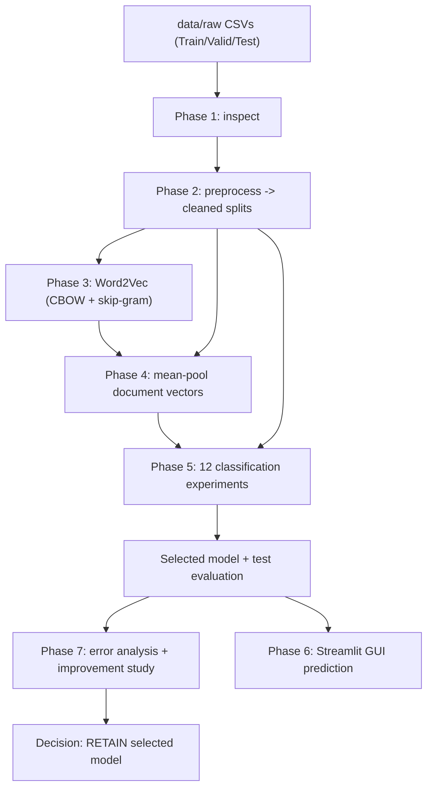
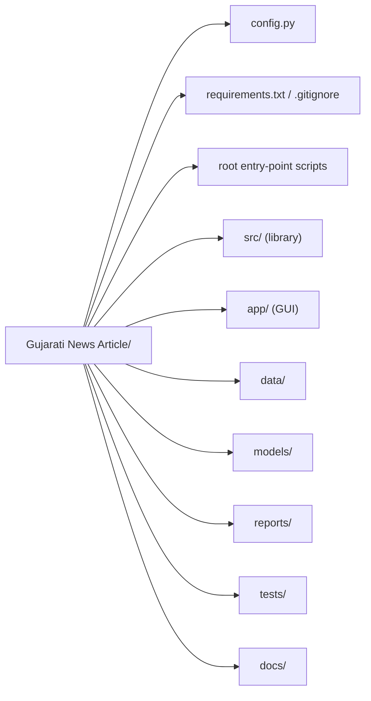
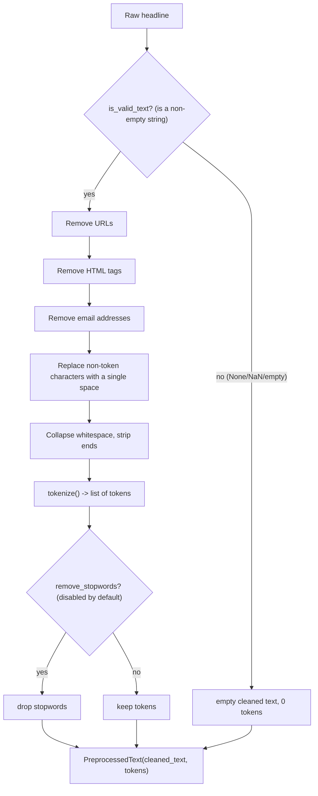
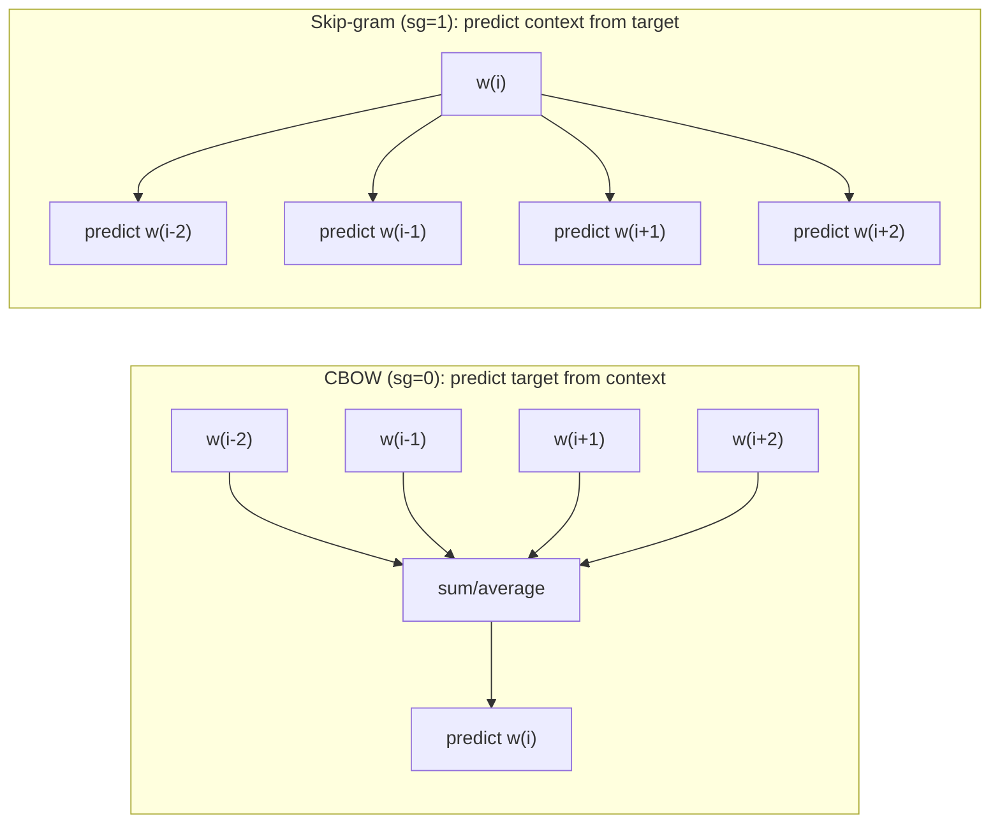
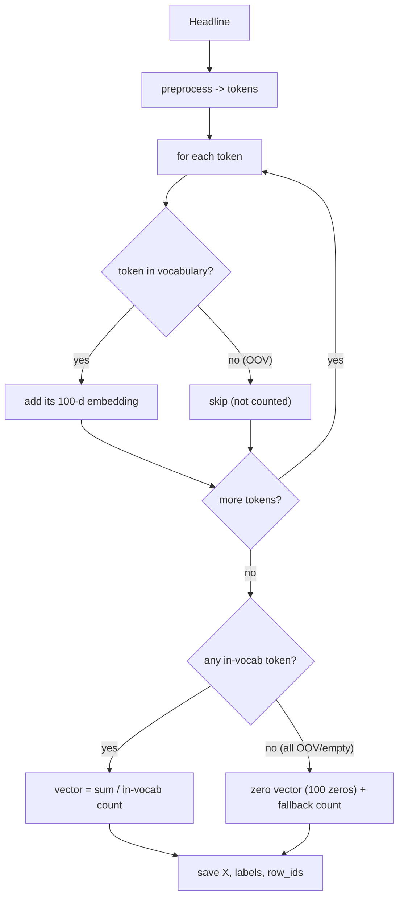
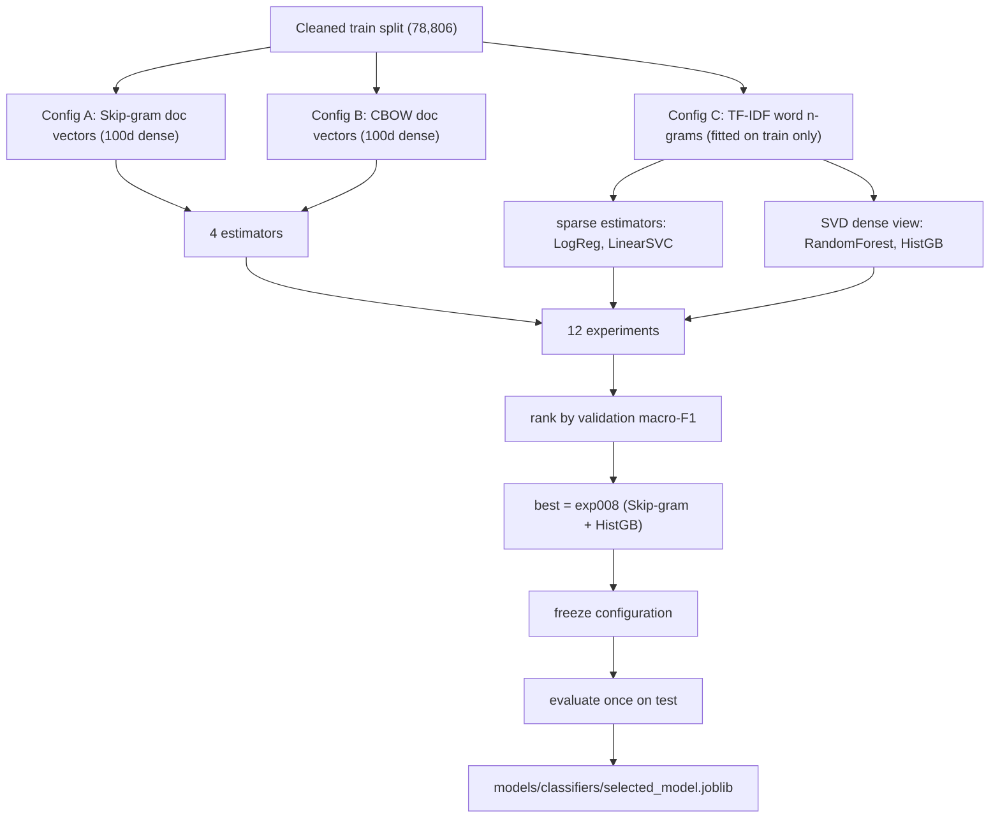
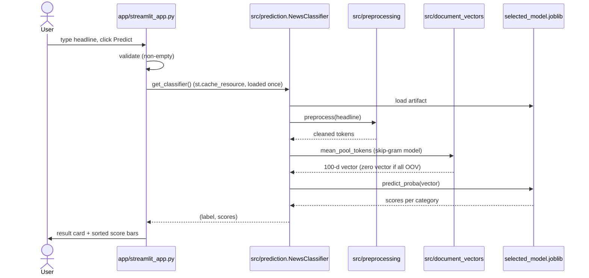
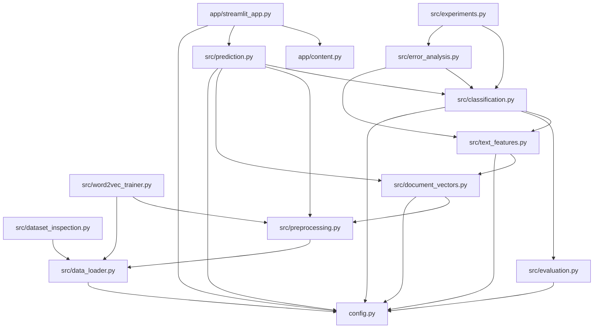

# Gujarati News Classifier - Complete Handbook

> **Consolidated edition.** This single document gathers all twelve chapters of
> the project handbook plus the eight architecture diagrams, in reading order.
> It is generated from the chapter sources under `docs/project_handbook/` so the
> two stay in sync. Every number and path below was read directly from the
> repository (source code, reports, and metadata); items that could not be
> verified are explicitly marked *unverified* or *inferred*.

## Contents

- 00 - How to use this handbook
- 01 - Project overview and goals
- 02 - Repository map
- 03 - The dataset
- 04 - Text preprocessing
- 05 - Word2Vec embeddings
- 06 - Document vectors
- 07 - Classification
- 08 - Error analysis and improvement (Phase 7)
- 09 - The Streamlit GUI
- 10 - Testing and operations
- 11 - Glossary, dependency graph, and references

---
## 00 — How to use this handbook


## Who this is for

- **New team members** who need to understand the project quickly.
- **Students / beginners** learning how a real NLP text-classification pipeline
  is assembled from classical (non-deep-learning) components.
- **Maintainers** who need to run, extend, or debug the system.

You should be able to read Python and use a terminal. No prior
knowledge of NLP, Gujarati, or machine learning is assumed — terms are explained
as they appear, and collected in Chapter 11.

## How the handbook is organised

Chapters follow the *life of one headline* through the system:

```
raw CSV  ->  inspect  ->  preprocess  ->  Word2Vec  ->  document vector
        ->  classifier  ->  evaluation  ->  GUI prediction
```

- **Chapters 01–03** describe the goal, the repository, and the data.
- **Chapters 04–07** walk the pipeline stage by stage (the core of the book).
- **Chapter 08** covers the Phase 7 error analysis and improvement study.
- **Chapters 09–10** cover the GUI and day-to-day operations/testing.
- **Chapter 11** is a glossary, a module dependency diagram, and pointers to the
  repository's own generated reports.

## How facts in this handbook were verified

This handbook was written by **reading the repository**, not by assuming how it
"usually" works. The following sources were inspected:

- **Source code:** `config.py`, everything in `src/`, `app/`, and the root
  entry-point scripts.
- **Generated reports:** files under `reports/` and `reports/error_analysis/`,
  `reports/experiments/`.
- **Model and feature artifacts:** `.meta.json` files under `data/processed/`,
  file listings under `models/`.
- **Phase plans:** the implementation plans under `docs/superpowers/plans/`.
- **The dataset itself:** the raw CSVs under `data/raw/`, read in a read-only
  way to confirm row counts, columns, class distributions, and samples.

### Accuracy conventions used here

| Marker | Meaning |
| --- | --- |
| (plain text) | Verified directly from the repository. |
| *inferred* | A reasonable conclusion that follows from verified facts but is not stated verbatim anywhere. |
| *unverified* / *not confirmed* | Could not be confirmed from the repository; treat with caution. |
| illustrative example | A made-up example used only to explain a concept. |

All numeric results (accuracy, macro-F1, row counts, vocabulary sizes) are quoted
**exactly** as they appear in the repository's own reports, so they can be
cross-checked.

## A note on the development environment

The project's plans mention a Python virtual environment at `.venv\Scripts\`.
During this documentation pass, **no `.venv` folder was present** in the project
root; a system Python 3.11 was available with the project's dependencies
installed. Chapter 10 explains how to create the virtual environment and install
dependencies (`requirements.txt`), so this discrepancy is expected and easy to
resolve. It does **not** affect the correctness of the documentation.

## Running things safely

The pipeline is **not** a single command; it is a series of scripts, each of
which reads inputs and writes artifacts/reports. Several steps are **expensive**
(training Word2Vec, generating document vectors, running the 12 classification
experiments) and some tests **overwrite** report files as a side effect. If you
only want to *use* the model, run the GUI (Chapter 09). If you want to
*reproduce* results, read Chapter 10 first.

Ready? Continue to Chapter 01 — Project overview and goals.

---

## 01 — Project overview and goals


## The problem

Gujarati is an Indo-Aryan language written in the **Gujarati script**, spoken by
tens of millions of people. News outlets such as ABP Asmita publish thousands of
Gujarati headlines every day. A useful first step in any news product is to sort
each article into a **category** (Politics/Nation, Sports, Business, and so on).

This project builds a **text classifier**: give it a Gujarati news headline, and
it returns the single most likely category out of ten, together with a score for
every category.

Because Gujarati is **morphologically rich** (words carry a lot of grammar in
their endings) and the dataset is modest in size, the project deliberately uses
**classical machine-learning methods** rather than deep neural networks:

- Word embeddings trained with **Word2Vec** (a lightweight, well-understood
  method), and
- Four classic scikit-learn classifiers.

This keeps training fast, results reproducible, and the whole pipeline
explainable — an excellent learning project and a solid, dependency-light
baseline.

## What the system predicts

Ten categories (defined in `config.py` as `CATEGORY_LABELS`):

| Category | Roughly means |
| --- | --- |
| State | News about Gujarat state and local governance |
| International | World affairs, foreign countries |
| Entertainment | Films, celebrities, culture, events |
| Business | Economy, markets, prices, companies |
| Nation | Indian national politics and policy |
| Technology | Gadgets, science, apps, IT |
| Sports | Cricket and other sports |
| Astro | Astrology and horoscopes |
| Crime | Police, arrests, court and law-and-order |
| Auto | Cars, vehicles, transport |

A common observation in the error analysis (Chapter 08) is that **State / Nation
/ International overlap heavily**, as do **Business / Nation / Technology** —
these are genuinely fuzzy boundaries even for humans.

## The eight phases of the project

The work was organised into numbered phases, each with its own implementation
plan under `docs/superpowers/plans/`:

| Phase | Name | Produces |
| --- | --- | --- |
| 1 | Dataset inspection | `reports/dataset_inspection_report.txt` |
| 2 | Preprocessing | `src/preprocessing.py`, `reports/preprocessing_report.txt` |
| 3 | Word2Vec training | `models/word2vec_{cbow,skipgram}.model`, report |
| 4 | Document vectors | `data/processed/*.docvecs.npz` + `.meta.json`, report |
| 5 | Classification | `models/classifiers/*`, `reports/classification_*` |
| 6 | GUI | `app/streamlit_app.py`, `app/content.py`, `app/README.md` |
| 7 | Error analysis + improvement | `reports/error_analysis/*`, `reports/experiments/*` |
| 8 | Documentation | **this handbook** |

## End-to-end architecture

> Diagram A — end-to-end flow (Mermaid source:
> `diagrams/A_system_architecture.mmd`).



*(The full-size diagrams live in `diagrams/`.)*

## Headline results

All numbers below are copied from the repository's own reports.

**Model selection (validation only)** — best of 12 experiments
(`reports/classification_validation_table.md`):

| Rank | Feature | Classifier | Macro-F1 | Accuracy |
| --- | --- | --- | --- | --- |
| 1 | Skip-gram doc vectors (100d) | gradient_boosting | 0.8883 | 0.8947 |
| 2 | Skip-gram doc vectors (100d) | logistic_regression | 0.8837 | 0.8896 |
| 3 | Skip-gram doc vectors (100d) | linear_svm | 0.8774 | 0.8848 |
| 4 | TF-IDF word n-grams | linear_svm | 0.8729 | 0.8747 |

**Frozen test evaluation** of the selected model
(`reports/classification_test_report.txt`):

| Metric | Value |
| --- | --- |
| Accuracy | 0.8953 |
| Macro precision | 0.8966 |
| Macro recall | 0.8862 |
| **Macro F1** | **0.8910** |
| Weighted F1 | 0.8952 |
| Test rows | 9,972 |

**Best and worst categories on test:** Sports (F1 0.9547) and Astro (F1 0.9672)
are easiest; Nation (0.7741) and Crime (0.7901) are hardest.

**Phase 7 outcome:** a further 15 experiments (exp100–exp114) were run on
validation. The best improved macro-F1 by only **+0.0006**, below the project's
**+0.005** replacement threshold, so the decision was to **RETAIN** the Phase 5
selected model (`reports/experiments/recommendation.md`). See Chapter 08.

## Scope, goals, and non-goals

**Goals**

- A reproducible, explainable, Gujarati-aware text-classification pipeline.
- No paid services, no network dependency at inference time, no deep learning.
- A clean GUI for non-technical users.
- Honest evaluation: select on validation, touch the test split exactly once.

**Non-goals (by design)**

- No deep-learning transformers (BERT-style) — intentionally out of scope.
- No automatic hyper-parameter search beyond the planned experiment grid.
- Not a production service: there is no REST API, database, or deployment config.
- The model predicts a **single** category per headline; it is not multi-label.

## Technology at a glance

Python 3.11 · pandas · NumPy · **gensim** (Word2Vec) · **scikit-learn**
(classifiers, TF-IDF, SVD, metrics) · joblib (model persistence) · matplotlib +
seaborn (plots) · **Streamlit** (GUI) · pytest (tests). Full details in
`requirements.txt` and Chapter 11.

Next: Chapter 02 — Repository map.

---

## 02 — Repository map


This chapter is your map of the codebase. Read it once and you will know where
everything lives.

## Top-level layout



A useful mental model: **`src/` is the library; the root scripts are thin
command-line front doors; `app/` is the interactive front door; `config.py` is
the single source of truth for paths, column names, and constants.**

## `config.py` — the control panel

Everything path- and constant-related is centralised here (199 lines):

- **Paths:** `PROJECT_ROOT`, `DATASET_DIR` (`data/raw`), `PROCESSED_DIR`
  (`data/processed`), `MODELS_DIR`, `CLASSIFIERS_DIR`, `EXPERIMENTS_DIR`,
  `REPORTS_DIR`, `ERROR_ANALYSIS_DIR`, `EXPERIMENTS_REPORT_DIR`, and the three
  CSV paths `TRAIN_PATH` / `VALID_PATH` / `TEST_PATH`.
- **Data contract:** `DATA_FORMAT = "SHC"`, `TEXT_COLUMN = "text"`,
  `LABEL_COLUMN = "labels"`, `TRAIN_ENCODING = "utf-8-sig"`.
- **Categories:** `CATEGORY_LABELS` — the 10 class names.
- **Modelling constants:** `RANDOM_SEED = 42`, `FEATURE_CONFIGURATIONS`,
  `TFIDF_WORD_PARAMS`, `W2V_MODEL_SKIPGRAM_PATH`, `W2V_MODEL_CBOW_PATH`,
  `CLASSIFIER_SVD_COMPONENTS`, and `REPLACEMENT_THRESHOLD = 0.005` (Phase 7).

> Why a single config? Because a stage like "where is the skip-gram model?"
> should have exactly one answer, so the pipeline, the GUI, and the tests all
> agree.

## Root entry-point scripts

Each script is a thin wrapper that calls the matching module and prints a
report. Run them from the project root.

| Script | Calls | Writes |
| --- | --- | --- |
| `inspect_dataset.py` | `src/dataset_inspection.py` | `reports/dataset_inspection_report.txt` |
| `preprocess_dataset.py` | `src/preprocessing.py` | `reports/preprocessing_report.txt` (+ optional `data/processed/*.preprocessed.csv`) |
| `train_word2vec.py` | `src/word2vec_trainer.py` | `models/word2vec_*.model`, `reports/word2vec_training_report.txt` |
| `generate_document_vectors.py` | `src/document_vectors.py` | `data/processed/*.docvecs.npz` + `.meta.json`, report |
| `run_classification.py` | `src/classification.py` | `models/classifiers/*`, `reports/classification_*` |
| `run_error_analysis.py` | `src/error_analysis.py` | `reports/error_analysis/*` |
| `run_model_improvement.py` | `src/experiments.py` | `models/experiments/*`, `reports/experiments/*` |

## `src/` — the library modules

| Module | Responsibility |
| --- | --- |
| `data_loader.py` | Read the three CSVs into a `DatasetSplits` object; structural validation. |
| `dataset_inspection.py` | Phase 1 reconnaissance and report. |
| `preprocessing.py` | Clean + tokenize Gujarati text (deterministic, reusable). |
| `word2vec_trainer.py` | Train CBOW and Skip-gram models; write report. |
| `document_vectors.py` | Mean-pool word vectors into 100-d headline vectors. |
| `text_features.py` | Load doc vectors; build leakage-safe TF-IDF; SVD reduction. |
| `evaluation.py` | Metrics, experiment records, comparison tables, plots. |
| `classification.py` | Estimators, experiment runner, model selection, save/load. |
| `prediction.py` | `NewsClassifier` — the single-inference interface. |
| `error_analysis.py` | Phase 7 error grouping and reporting. |
| `experiments.py` | Phase 7 improvement experiments + retain/replace decision. |

## `app/` — the GUI

| File | Role |
| --- | --- |
| `streamlit_app.py` | The Streamlit view (671 lines): hero, input box, result, scores, category grid, model info. |
| `content.py` | Static content and pure helpers (273 lines): `CATEGORY_INFO`, `EXAMPLE_HEADLINES`, `METHODOLOGY_STEPS`, `MODEL_DISPLAY`, score formatting. Importable **without** Streamlit so it is unit-testable. |
| `README.md` | App-specific run/usage/troubleshooting notes. |

## `data/`

| Folder | Contents |
| --- | --- |
| `data/raw/` | The three original CSVs: `Gujarati_SHC_LDC_LPC_Train.csv`, `..._Valid.csv`, `..._Test.csv`. Never modified by the pipeline. |
| `data/processed/` | `*.docvecs.npz` + `*.meta.json` per model per split (the model inputs). Also `*.preprocessed.csv` cleaned-text dumps that are **regenerable and not read at runtime** (see Chapter 10). |

## `models/`

| Path | Contents |
| --- | --- |
| `word2vec_cbow.model` (+ `.wv.vectors.npy`) | Trained CBOW embeddings. |
| `word2vec_skipgram.model` (+ `.wv.vectors.npy`, `.syn1neg.npy`) | Trained Skip-gram embeddings — **required at inference**. |
| `classifiers/selected_model.joblib` | The chosen classifier + metadata. |
| `classifiers/exp001..exp012` | The 12 Phase 5 experiment artifacts. |
| `experiments/exp100..exp114` | The 15 Phase 7 experiment artifacts. |
| `backup/*.corrupted-raw-train.model` | Archived corrupted model files kept for reference. |

## `reports/`

Human-readable evidence of every phase: `dataset_inspection_report.txt`,
`preprocessing_report.txt`, `word2vec_training_report.txt`,
`document_vectors_report.txt`, `classification_report.txt` (Phase 5),
`classification_test_report.txt`, `classification_validation_table.md`,
`classification_experiments.csv|json`, plus `reports/error_analysis/` and
`reports/experiments/` from Phase 7.

## `tests/`

15 pytest files covering every module (see Chapter 10). Notable specifics:
`tests/conftest.py` holds shared fixtures, and two tests intentionally write real
reports as a side effect — read Chapter 10 before running the full suite if you
care about report contents.

## `docs/`

`docs/superpowers/plans/` holds the five phase implementation plans (primary
sources for this handbook); `docs/project_handbook/` is this handbook.

## A suggested reading order in the code

1. `config.py` — the vocabulary of the project.
2. `src/data_loader.py` — how data enters.
3. `src/preprocessing.py` — how text is cleaned.
4. `src/word2vec_trainer.py` → `src/document_vectors.py` — how text becomes numbers.
5. `src/text_features.py` → `src/classification.py` → `src/evaluation.py` —
   how numbers become a model and a score.
6. `src/prediction.py` → `app/streamlit_app.py` — how a user gets an answer.
7. `src/error_analysis.py` → `src/experiments.py` — how the model was audited.

Next: Chapter 03 — The dataset.

---

## 03 — The dataset


## Where the data lives

```
data/raw/
  Gujarati_SHC_LDC_LPC_Train.csv
  Gujarati_SHC_LDC_LPC_Valid.csv
  Gujarati_SHC_LDC_LPC_Test.csv
```

The filename encodes the format: **SHC** (the active format here) and LDC/LPC
(alternate formats that the loader recognises but that are **not** present).
`config.DATA_FORMAT = "SHC"`.

## What the files look like

Each CSV is **two columns**:

| Column | Meaning | Config constant |
| --- | --- | --- |
| `text` | The news headline (Gujarati) | `config.TEXT_COLUMN` |
| `labels` | The category name | `config.LABEL_COLUMN` |

- **Encoding:** read with `utf-8-sig` (`config.TRAIN_ENCODING`), which strips a
  possible byte-order mark at the start of the file. Gujarati text is Unicode, so
  correct encoding matters.
- A headline can be **long** (a full multi-sentence article body in some rows) or
  a **short** title.

### Illustrative shape of a row

```text
text  : "ભારતે નવો રેકોર્ડ બનાવ્યો"          (illustrative)
labels: "Nation"
```

## Sizes: raw vs. cleaned

Two sets of counts matter, and they differ because preprocessing **drops empty
or invalid rows**.

| Split | Rows in raw CSV | Rows after cleaning |
| --- | --- | --- |
| Train | 79,416 | **78,806** |
| Validation | 10,251 | **10,175** |
| Test | 10,041 | **9,972** |

The cleaned counts (78,806 / 10,175 / 9,972) are the numbers every later stage
uses and asserts. They are the project's canonical row counts.

## Missing values and data quirks

The raw files contain some missing values. The inspection report found:

| Split | Missing `text` | Missing `labels` |
| --- | --- | --- |
| Train | 605 | 0 |
| Validation | 74 | 3 |
| Test | 69 | 3 |

Rows with an empty/invalid text (or unusable label) are removed during
preprocessing, which is why cleaned counts are smaller. The 3 missing validation
labels and 3 missing test labels explain part of the reduction there.

## Class distribution (raw CSVs)

The dataset is **imbalanced**: State and International are roughly 5× larger than
Auto. This directly shapes the metrics used later — **macro-F1** weights every
class equally and is the project's selection metric precisely because plain
accuracy would flatter the big classes.

**Train (raw, 79,416 rows):**

| Category | Count |
| --- | --- |
| State | 12,552 |
| International | 12,195 |
| Entertainment | 8,895 |
| Business | 8,871 |
| Nation | 8,742 |
| Technology | 7,881 |
| Sports | 7,116 |
| Astro | 6,897 |
| Crime | 3,720 |
| Auto | 2,547 |

**Validation (raw, 10,251 rows):**

| Category | Count |
| --- | --- |
| State | 1,629 |
| International | 1,494 |
| Nation | 1,182 |
| Business | 1,179 |
| Entertainment | 1,134 |
| Sports | 1,044 |
| Technology | 927 |
| Astro | 840 |
| Crime | 486 |
| Auto | 333 |
| *(missing)* | 3 |

## The cardinal rule: split integrity

The three splits are **fixed and never reshuffled**:

- The model is **trained** only on train.
- **Everything that involves a choice** (TF-IDF vocabulary, model selection) uses
  train + validation.
- The **test split is touched exactly once**, after the configuration is frozen,
  to produce the final numbers.

This is the standard way to avoid **data leakage** (accidentally letting the
model "see" the answers). The plans and reports repeatedly assert the exact row
counts and positional label alignment to guarantee no row ever crosses splits.

## Known quirks and their consequences

1. **Morphological richness.** Gujarati packs grammar into word endings, so the
   same idea appears as many surface forms; `min_count=2` in Word2Vec keeps only
   handles the rare tail.
2. **Mixed script.** Many headlines contain ASCII (English) fragments — brand
   names, "By:", `#hashtags`, URLs, "Updated at : ... (IST)". The error report
   found **6,259 validation headlines** contain ASCII letters. Cleaning removes
   URLs/HTML/emails but keeps word characters, so some English survives.
3. **Very long "headlines".** Some rows are full article bodies (hundreds of
   tokens), while others are a few words. Length affects behaviour: the error
   analysis showed an error rate of ~0.13 for 8–15 token rows vs. ~0.099 for
   16+ token rows.
4. **Genuinely overlapping categories.** State vs. Nation vs. International, and
   Business vs. Nation vs. Technology, share vocabulary and topic space. These
   are the dominant confusions (Chapter 08).

## Why this dataset is a good fit for the approach

It is big enough to train Word2Vec embeddings from scratch (tens of thousands of
headlines) but small enough that classical models converge quickly and results
stay reproducible on a laptop. That is exactly the regime where
**Word2Vec + gradient boosting** shines without needing GPUs or transformers.

Next: Chapter 04 — Text preprocessing.

---

## 04 — Text preprocessing


**Module:** `src/preprocessing.py` · **Entry point:** `preprocess_dataset.py` ·
**Report:** `reports/preprocessing_report.txt`

## Why preprocess at all?

Raw headlines are messy. They contain URLs, HTML fragments, email addresses,
punctuation, extra whitespace, and sometimes nothing at all. Word2Vec learns from
**tokens** (words), so before training we must turn each string into a clean list
of tokens — without changing Gujarati's meaning.

The guiding principle for this project: **clean conservatively**. It removes
noise but never strips Gujarati's own characters, and it never changes text in a
way that would alter meaning.

## The Gujarati-script concern

Gujarati is written with consonants plus **vowel signs** (matras) and other
combining marks in the Unicode range **U+0ABE–U+0AC5**. These marks change how a
letter is pronounced. A naive "remove non-alphanumeric characters" step would
**destroy** Gujarati words by deleting the matras.

So the design explicitly guarantees: **vowel signs survive cleaning and
tokenization unchanged.** This is the single most important rule in this module,
and a dedicated test enforces it.

## The pipeline, step by step



Key details:

- **URL / HTML / email removal** happens first so their characters never leak
  into tokens.
- **Punctuation → space (not delete).** Replacing a comma with a *space* prevents
  accidentally gluing two words together; deleting it would merge them.
- **Whitespace collapse** is deterministic, so calling the cleaner twice gives
  the same result (important for reproducibility).
- **Stopword removal is off by default.** Gujarati has very frequent function
  words (like છે / અને), but removing them by default risks harming short
  headlines; the project exposes a documented, small stopword list and leaves it
  **optional**.

## The main API

All functions are pure and deterministic (given the same input, always the same
output), and type-annotated:

| Function | Purpose |
| --- | --- |
| `is_valid_text(x)` | `True` only for a non-empty string; `False` for `None`/NaN/empty. |
| `clean_text(text)` | Removes URLs/HTML/emails, replaces non-token chars with space, collapses whitespace. |
| `normalize_whitespace(text)` | Deterministic whitespace collapse/trim. |
| `tokenize(text)` | Splits cleaned text into a list of tokens. |
| `remove_stopwords(tokens)` | Optional stopword removal. |
| `preprocess(text)` | One call → a `PreprocessedText` dataclass with `cleaned_text` and `tokens`. |
| `add_preprocessed_columns(df)` | Returns a **copy** with added cleaned columns; original text and labels preserved. |
| `preprocess_splits(splits)` | Applies the above to all three splits. |
| `build_preprocessing_report(...)`, `write_report(...)` | Build/write `reports/preprocessing_report.txt`. |
| `run_preprocessing_pipeline(...)` | End-to-end: load → preprocess → report (+ optional save). |

## Design decisions worth remembering

| Decision | Reason |
| --- | --- |
| Never modify the original CSVs. | Reproducibility; originals are the source of truth. |
| Keep original text alongside cleaned text (`PreprocessedText`). | Debugging and auditing — you can always see what was removed. |
| Replace punctuation with spaces, not with nothing. | Avoid joining unrelated words. |
| Deterministic, side-effect-free functions. | Reusable identically at training and inference time. |
| No English stemming, no English stopword list, no meaning-changing normalization. | The target language is Gujarati; English tools would corrupt it. |
| Stopwords optional and off. | Avoid throwing away signal in short headlines. |

## An illustrative before/after

```
input : "ગુજરાતી સમાચાર,! https://example.com વાંચો"
clean : "ગુજરાતી સમાચાર વાંચો"
tokens: ["ગુજરાતી", "સમાચાર", "વાંચો"]
```

*(Illustrative only — used to show the effect of URL and punctuation handling.)*

## Robustness rules (enforced by tests)

- `None`, `NaN`, or an empty string **never** raises; they yield empty text and
  zero tokens.
- Gujarati vowel signs are preserved exactly.
- Repeated calls produce identical output.
- Labels and original columns are untouched.
- Processing one split never loads another format.

## Where preprocessing is reused

The **same** `preprocess()` function is used to prepare Word2Vec training
sentences (Chapter 05), to build document vectors (Chapter 06), and at **inference
time** in the GUI (Chapter 09). This consistency is deliberate: if training and
inference cleaned text differently, the model would see a different distribution
and accuracy would drop.

Next: Chapter 05 — Word2Vec embeddings.

---

## 05 — Word2Vec embeddings


**Module:** `src/word2vec_trainer.py` · **Entry point:** `train_word2vec.py` ·
**Report:** `reports/word2vec_training_report.txt`

## The idea in one minute

A computer cannot compare words directly, but it can compare **numbers**. A word
**embedding** assigns each word a list of numbers (a vector) such that words used
in similar contexts end up with similar vectors. "Similar" here means
*geometrically close*, e.g. by cosine similarity.

**Word2Vec** (Mikolov et al., 2013) is a classical, fast method to learn these
vectors from raw text *without any labels*. It does this by repeatedly solving a
simple prediction game over a sliding window of words. Because it needs no labels,
it can learn from all 78,806 training headlines — labels are never used here.

The trained vectors capture real relationships. The report's nearest-neighbour
probe for the word **'ગુજરાતી'** ("Gujarati") returns related words:

- CBOW: `રંગભૂમિમાં` (0.599), `ઝુલન` (0.588), `પંજાબી` (0.585), `મલયાલમ` (0.558), `નાયિકા` (0.557)
- Skip-gram: `આલ્બમની` (0.648), `રચનાઓથી` (0.640), `રંગભૂમિમાં` (0.626), `રમાનારો` (0.613), `ફરજીજિયાત` (0.610)

*(Illustrative interpretation: these are artists/languages/creative terms, which
is plausibly "news about culture/language" — a good sign the embeddings learned
something meaningful.)*

## CBOW vs Skip-gram

Two training variants are trained here. They differ only in which direction the
prediction runs.



| | CBOW | Skip-gram |
| --- | --- | --- |
| Predicts | the centre word from its neighbours | each neighbour from the centre word |
| Speed | faster | slower |
| Rare words | tends to smooth them away | usually represents them better |
| In this project | `sg=0` | `sg=1` — **the winner** |

In practice, Skip-gram produced the better downstream classifier here, which is
consistent with it handling rarer vocabulary more gracefully.

## Exact training configuration

Both models were trained on the cleaned **train split only** with identical
settings (from the report):

| Parameter | Value | Meaning |
| --- | --- | --- |
| `vector_size` | 100 | each word becomes 100 numbers |
| `window` | 5 | look 5 words left/right for context |
| `min_count` | 2 | ignore words seen only once |
| `workers` | 8 | parallel training threads |
| `seed` | 42 | reproducibility |
| `epochs` | 10 | passes over the data |
| `sg` | 0 (CBOW) / 1 (Skip-gram) | the variant |

Training facts (verified):

- Training headlines processed: **78,806**; empty token lists: **0**.
- Tokens discarded for being too rare (`freq < min_count`): **18,539**.
- Rows containing Gujarati: **78,606**; Gujarati Unicode characters:
  **54,358,451**.
- **Vocabulary size: 210,459** words (both models).
- Gujarati words in vocabulary: **179,442 / 210,459 (85.3%)**.
- Model artifact size: ≈ **9.37 MB** each (9,369,176 / 9,369,178 bytes).

> **Reproducibility note:** the report records `gensim fast version: 0`, meaning
> the exact-match, deterministic training path was used. This supports the
> "same seed → same vectors" expectation, though identical results across
> machines/thread counts is best treated as *likely, not guaranteed*.

## Leakage discipline

The report states plainly: validation and test text were **not** used to train
the embeddings, and the labels were **not** used at all (Word2Vec is
unsupervised). This is essential — if the embeddings had seen test text, the
final test scores would be optimistic and meaningless.

## The artifacts on disk (and an important subtlety)

Gensim saves a Word2Vec model as a `.model` file **plus** sidecar NumPy files:

```
models/word2vec_skipgram.model
models/word2vec_skipgram.model.wv.vectors.npy   # the embedding matrix
models/word2vec_skipgram.model.syn1neg.npy      # training weights
```

**These sidecars are required.** `Word2Vec.load(...)` fails if the
`.wv.vectors.npy` (and `.syn1neg.npy`) files are missing. This matters for
deployment: copying only the `.model` file is a common mistake. See the GUI
chapter's troubleshooting section.

## Why 100 dimensions?

100 is a common, well-balanced choice: enough capacity to encode meaning, small
enough to train quickly and keep the downstream feature vectors compact. It also
means every headline becomes a 100-number vector (Chapter 06) — a very usable
size for gradient boosting.

## Out-of-vocabulary (OOV) words

Any word not in the 210,459-word vocabulary is **OOV**. The model simply cannot
look it up. OOV is expected, especially in validation/test (the vocabulary was
learned from train alone, so validation/test naturally contain unseen words):
the test split had **42,919 OOV tokens**. The document-vector stage decides how
to handle them (Chapter 06) — it skips OOV tokens rather than treating them as
zeros, so they do not dilute the averages.

Next: Chapter 06 — Document vectors.

---

## 06 — Document vectors


**Module:** `src/document_vectors.py` · **Entry point:**
`generate_document_vectors.py` · **Report:** `reports/document_vectors_report.txt`

## The problem this stage solves

A **word vector** is fixed-length (100 numbers), but a **headline** is a variable
number of words. Classifiers like gradient boosting need **one fixed-length row
per headline**. So we must compress each headline's words into a single vector.
This "whole document → one vector" object is called a **document vector** (here,
really a headline vector).

## The method: mean pooling

The project uses **mean pooling**: take the 100-d vector of each word in the
headline, add them up, and divide by the number of words. The result is a single
100-d vector that summarises the headline.



### Two subtle rules that matter

1. **OOV tokens are skipped, not zeroed.** If a headline has 10 tokens and 2 are
   OOV, the average divides by **8**, not 10. Treating OOV as a zero vector would
   pull the headline's vector toward the origin and blur its meaning — a classic
   mistake this design deliberately avoids.
2. **The all-OOV fallback.** If *every* token is OOV (or the headline is empty),
   there is nothing to average. Instead of crash or `NaN`, the stage returns a
   **zero vector** and counts that headline as a **fallback**. Fallbacks are rare
   and are reported, not hidden.

## What is produced

For each **(model, split)** combination — 2 models × 3 splits = **6 files** —
the stage writes:

- `data/processed/<name>.<model>.docvecs.npz` — compressed arrays:
  - `X` — the feature matrix, shape `(rows, 100)`, float32
  - `labels` — the category per row
  - `row_ids` — a stable positional id (0,1,2,…) for alignment
- `data/processed/<name>.<model>.docvecs.meta.json` — a small JSON describing the
  file (model, dimension, row counts, fallback counts, OOV/in-vocab token
  totals, vocabulary size, paths).

Example filenames: `Gujarati_SHC_LDC_LPC_Train.skipgram.docvecs.npz` and its
`.meta.json`.

## Verified outputs

**Row counts match input exactly, for every split and both models**
(`reports/document_vectors_report.txt`): train **78,806**, validation **10,175**,
test **9,972**. All matrices are `(rows, 100)`, `finite=True`, and pass a
`dimension_ok=True` check.

**Fallback / OOV statistics** (identical for CBOW and Skip-gram, since the
vocabulary is identical):

| Split | Fallback (all-OOV) rows | OOV tokens | In-vocab tokens | Mean in-vocab / headline |
| --- | --- | --- | --- | --- |
| train | 1 / 78,806 (0.0013%) | 120,634 | 12,223,859 | 155.11 |
| validation | 0 / 10,175 (0.0000%) | 45,279 | 1,557,385 | 153.06 |
| test | 1 / 9,972 (0.0100%) | 42,919 | 1,516,120 | 152.04 |

Read this as a health report: only **one** headline in the entire train and test
sets was all-OOV, and none in validation. The mean number of usable words per
headline (~152) is high because many "headlines" are full article bodies.

**Label and row-order alignment** are explicitly checked: `row_ids_sequential=True`
and `labels_aligned=True` for all six files. This guarantees row *i* of the
feature matrix, its label, and its `row_id` all refer to the same headline — a
prerequisite for trustworthy training and evaluation.

## Leakage discipline

The report confirms: models were loaded **read-only**, Word2Vec was **not**
retrained, no classifier was trained, and validation/test text was never used to
train or update the embeddings.

## Why this design is a good choice

- **Fixed length** — works with any tabular classifier.
- **Uses meaning** — because the pooled word vectors are semantic, similar
  headlines land near each other even with different wording.
- **Simple and fast** — mean pooling is trivial to compute and to explain.
- **Honest about failure** — the rare all-OOV case is handled explicitly and
  measured rather than ignored.

## Limitation to be aware of

Mean pooling ignores **word order** and **which word matters most**. "The budget
was a disaster for the common man" and "The common man was a disaster for the
budget" would pool to the same vector. For headline classification this is
usually acceptable, and the strong results (Chapter 07) bear that out. Converting
a headline to a vector is also O(1) per word: fast enough for interactive use,
which is why the GUI can predict instantly.

Next: Chapter 07 — Classification.

---

## 07 — Classification


**Modules:** `src/text_features.py`, `src/evaluation.py`, `src/classification.py`,
`src/prediction.py` · **Entry point:** `run_classification.py` ·
**Reports:** `reports/classification_report.txt` (validation),
`reports/classification_test_report.txt` (test),
`reports/classification_validation_table.md`, `reports/classification_experiments.csv|json`

## The goal

Given the 100-d document vector (or a TF-IDF representation) of a headline,
predict one of the **10 categories**. The project compares **four classifiers**
across **three feature configurations** — 12 experiments — selects the best by
**validation macro-F1**, then evaluates that single frozen configuration on the
test split once.



## The three feature configurations

| Config | Feature | Representation | Why |
| --- | --- | --- | --- |
| **A** | Skip-gram document vectors | 100-d **dense** | semantic meaning, best performer |
| **B** | CBOW document vectors | 100-d **dense** | comparison against Skip-gram |
| **C** | TF-IDF word n-grams | **sparse** | strong classical text baseline |

### A and B — dense document vectors

Loaded directly from the `.npz` files of Chapter 06 (`src/text_features.py`,
`load_docvec_split`). The loader validates the shape is 2-D, all values finite,
and `row_ids == arange`, so a corrupted or misaligned file is caught immediately.

### C — TF-IDF, and the leakage rule that defines it

**TF-IDF** (Term Frequency–Inverse Document Frequency) scores each word by how
often it appears in a headline *and* how rare it is overall — common words count
little, distinctive words count a lot. It produces a large **sparse** matrix
(one column per vocabulary word).

The critical rule (enforced by a dedicated test):

> **The TF-IDF vectorizer is fitted on the training text only.** Validation and
> test text are only *transformed* with the already-fitted vectorizer.

If the vectorizer were allowed to see validation/test words while choosing its
vocabulary, information would leak and scores would be inflated. The test suite
explicitly checks that a token appearing only in validation is **absent** from
the fitted vocabulary.

### Why trees get an SVD view

Tree models (Random Forest, Gradient Boosting) do **not** cope well with the huge
sparse TF-IDF matrix — it is both memory-heavy and statistically awkward. So for
Config C, these two estimators are trained on a **truncated-SVD** (a.k.a.
Latent Semantic Analysis) **dense** reduction with a set number of components
(`config.CLASSIFIER_SVD_COMPONENTS`). This is a **documented, justified
adaptation**, not a silent hack. Logistic Regression and Linear SVM handle the
raw sparse matrix directly, since they are built for it.

## The four classifiers

Defined in `src/classification.py` (`CLASSIFIER_NAMES`):

| Name | Model | Strength |
| --- | --- | --- |
| `logistic_regression` | multinomial logistic regression | fast, strong linear baseline |
| `linear_svm` | linear support vector classifier | sharp linear boundaries |
| `random_forest` | Random Forest | nonlinear, robust, slower |
| `gradient_boosting` | `HistGradientBoostingClassifier` | best nonlinear accuracy here |

All are deterministic given `RANDOM_SEED = 42`, and the runner records whether a
config used SVD (`reduced_dim`) etc.

## The 12 experiments and their results (validation)

Ranked by macro-F1 (`reports/classification_validation_table.md`). **The entire
selection decision used validation only.**

| Rank | Exp | Feature | Classifier | Macro-F1 | Accuracy | W-F1 | Macro-P | Macro-R |
| --- | --- | --- | --- | --- | --- | --- | --- | --- |
| 1 | 8 | Skip-gram docvec | gradient_boosting | **0.8883** | **0.8947** | 0.8942 | 0.8952 | 0.8826 |
| 2 | 5 | Skip-gram docvec | logistic_regression | 0.8837 | 0.8896 | 0.8891 | 0.8897 | 0.8787 |
| 3 | 6 | Skip-gram docvec | linear_svm | 0.8774 | 0.8848 | 0.8834 | 0.8857 | 0.8715 |
| 4 | 10 | TF-IDF | linear_svm | 0.8729 | 0.8747 | 0.8741 | 0.8793 | 0.8679 |
| 5 | 7 | Skip-gram docvec | random_forest | 0.8689 | 0.8771 | 0.8756 | 0.8847 | 0.8583 |
| 6 | 4 | CBOW docvec | gradient_boosting | 0.8628 | 0.8687 | 0.8680 | 0.8746 | 0.8536 |
| 7 | 9 | TF-IDF | logistic_regression | 0.8627 | 0.8646 | 0.8642 | 0.8810 | 0.8497 |
| 8 | 1 | CBOW docvec | logistic_regression | 0.8585 | 0.8650 | 0.8642 | 0.8654 | 0.8532 |
| 9 | 2 | CBOW docvec | linear_svm | 0.8507 | 0.8582 | 0.8563 | 0.8596 | 0.8450 |
| 10 | 3 | CBOW docvec | random_forest | 0.8337 | 0.8451 | 0.8427 | 0.8573 | 0.8199 |
| 11 | 12 | TF-IDF | gradient_boosting | 0.8137 | 0.8154 | 0.8150 | 0.8312 | 0.8012 |
| 12 | 11 | TF-IDF | random_forest | 0.7840 | 0.7857 | 0.7845 | 0.8163 | 0.7662 |

**Takeaways:**

- **Semantic document vectors beat raw TF-IDF** at the top of the table — pooling
  learned word meanings is worth more than word counts.
- **Skip-gram beats CBOW** on every estimator for the top rows.
- **Gradient boosting wins** overall, but by a modest margin over logistic
  regression (0.8883 vs 0.8837).
- Surprisingly, TF-IDF + gradient boosting / random forest (ranks 11–12) are the
  *worst* — the SVD reduction plus trees is not the strongest combination, which
  is exactly why the project ran the full grid instead of guessing.

### The selection rule

`select_best(results)` picks the highest **macro-F1**, breaking ties by accuracy.
The winner is **experiment 8**: `docvec:skipgram` + `gradient_boosting`
(`learning_rate=0.1, max_iter=200, seed=42`).

## Why macro-F1, not accuracy?

The classes are imbalanced (State ≈ 12.5k rows, Auto ≈ 2.5k). Plain **accuracy**
is dominated by the large classes and would hide poor performance on small ones.
**Macro-F1** averages the F1 of each class equally, so every category counts the
same. That makes it the honest choice for a 10-class imbalanced problem — and the
project uses it consistently for selection and reporting.

(Definitions of precision/recall/F1 are in Chapter 11.)

## Frozen test evaluation

After selection, the configuration is **frozen** and evaluated **once** on the
untouched test split (`reports/classification_test_report.txt`):

| Metric | Value |
| --- | --- |
| Accuracy | 0.8953 |
| Macro precision | 0.8966 |
| Macro recall | 0.8862 |
| **Macro F1** | **0.8910** |
| Weighted F1 | 0.8952 |
| Test rows | 9,972 |

**Per-class test metrics** (easiest and hardest):

| Category | Precision | Recall | F1 | Support |
| --- | --- | --- | --- | --- |
| Astro | 0.9779 | 0.9567 | **0.9672** | 924 |
| Sports | 0.9627 | 0.9469 | 0.9547 | 1,035 |
| Auto | 0.9664 | 0.8649 | 0.9128 | 333 |
| State | 0.9221 | 0.9421 | 0.9320 | 1,521 |
| Entertainment | 0.9192 | 0.9245 | 0.9218 | 1,046 |
| Technology | 0.8794 | 0.8959 | 0.8876 | 855 |
| International | 0.8825 | 0.9041 | 0.8931 | 1,553 |
| Business | 0.8719 | 0.8815 | 0.8767 | 1,089 |
| Crime | 0.8033 | 0.7773 | **0.7901** | 494 |
| Nation | 0.7801 | 0.7683 | **0.7741** | 1,122 |

Distinctive categories (Astro, Sports, Auto) are easy; abstract, overlapping ones
(Nation, Crime, Business) are hard. Chapter 08 explains *why*.

## The confusion matrix (test)

The report includes the full 10×10 confusion matrix. The striking, expected
patterns:

- **Nation ↔ International / Business / Crime / Technology** dominate the errors.
- **State ↔ Crime** are heavily entangled (Crime rows predicted as State, and
  State rows predicted as Crime).
- **Auto** is often misclassified as **Technology** (both involve vehicles/gadgets).

## The inference interface

`src/prediction.py` provides the single reusable entry point:

```python
from src.prediction import NewsClassifier

clf = NewsClassifier.load("models/classifiers/selected_model.joblib")
clf.predict("ભારતે નવો રેકોર્ડ બનાવ્યો")        # -> "Nation"   (illustrative)
label, scores = clf.predict_with_scores(headline) # -> ("Nation", {..10 scores..})
```

`NewsClassifier.load` reads the joblib artifact, which includes the classifier
**and** the metadata needed to rebuild features (feature type, class names, and —
for TF-IDF models — the fitted vectorizer/SVD). For the selected doc-vector model
it also lazily loads the Skip-gram Word2Vec model to embed the headline.

**Empty or whitespace input raises a clear `ValueError`** rather than silently
predicting; a headline whose words are all OOV still returns a label via the
zero-vector path (Chapter 06).

## Artifacts produced

- `models/classifiers/exp001..exp012` — every experiment's model.
- `models/classifiers/selected_model.joblib` — the frozen winner.
- `reports/classification_report.txt` — validation-phase summary.
- `reports/classification_validation_table.md` — the ranking above.
- `reports/classification_test_report.txt` — the frozen test metrics + confusion matrix.
- `reports/classification_experiments.csv|json` — machine-readable experiment log.
- Confusion-matrix and metric-comparison **plots** under `reports/`.

Next: Chapter 08 — Error analysis and improvement.

---

## 08 — Error analysis and improvement (Phase 7)


**Modules:** `src/error_analysis.py`, `src/experiments.py` ·
**Entry points:** `run_error_analysis.py`, `run_model_improvement.py` ·
**Reports:** `reports/error_analysis/*`, `reports/experiments/*` ·
**Plan:** `docs/superpowers/plans/2026-10-18-gujarati-error-analysis-model-improvement.md`

## Why this phase exists

A single accuracy number does not tell you *where* or *why* a model fails. Phase 7
does two things:

1. **Error analysis** — study the model's mistakes on the **validation** split.
2. **Model improvement** — try targeted changes and decide **retain or replace**
   the selected model using an explicit, pre-registered threshold.

**cardinal rule:** all of this uses **validation only**. The test split is never
inspected here.

## Step 1 — Reproduce the baseline first

Before analysing errors, the project re-loads the frozen selected model
**read-only** and re-evaluates it on validation. If the numbers didn't match the
original Phase 5 run, any later conclusion would be suspect. They matched exactly
(`reports/error_analysis/baseline_reproduction.md`, tolerance 0.001):

| Metric | Reproduced | Recorded | Difference |
| --- | --- | --- | --- |
| Accuracy | 0.894742 | 0.894742 | 0.00e+00 |
| Macro precision | 0.895153 | 0.895153 | 0.00e+00 |
| Macro recall | 0.882586 | 0.882586 | 0.00e+00 |
| Macro F1 | 0.888274 | 0.888274 | 0.00e+00 |
| Weighted F1 | 0.894235 | 0.894235 | 0.00e+00 |

Verdict: **reproduction matches**. The baseline is trustworthy.

## Step 2 — What the errors look like

From `reports/error_analysis/validation_error_analysis.md`:

- Validation examples: **10,175**; misclassified: **1,071**; error rate **0.1053 (10.53%)**.

**Per-class validation metrics** — the weak spots are Nation and Crime:

| Category | Precision | Recall | F1 | Support |
| --- | --- | --- | --- | --- |
| State | 0.9210 | 0.9470 | 0.9338 | 1,624 |
| International | 0.8645 | 0.9183 | 0.8906 | 1,494 |
| Entertainment | 0.9342 | 0.9136 | 0.9238 | 1,134 |
| Business | 0.8845 | 0.8770 | 0.8807 | 1,179 |
| **Nation** | 0.8004 | 0.7671 | **0.7834** | 1,181 |
| Technology | 0.8731 | 0.9130 | 0.8926 | 874 |
| Sports | 0.9576 | 0.9511 | 0.9543 | 1,044 |
| Astro | 0.9600 | 0.9452 | 0.9526 | 839 |
| **Crime** | 0.8203 | 0.7432 | **0.7798** | 479 |
| Auto | 0.9360 | 0.8502 | 0.8910 | 327 |

**Top confusion pairs** (true → predicted):

| Rank | True → Predicted | Count | Share of all errors |
| --- | --- | --- | --- |
| 1 | Nation → International | 97 | 0.0906 |
| 2 | Crime → State | 61 | 0.0570 |
| 3 | Business → Nation | 50 | 0.0467 |
| 4 | Nation → Business | 50 | 0.0467 |
| 5 | Crime → Nation | 44 | 0.0411 |
| 6 | Business → Technology | 43 | 0.0401 |
| 7 | International → Nation | 43 | 0.0401 |
| 8 | Entertainment → Nation | 38 | 0.0355 |
| 9 | Business → International | 36 | 0.0336 |
| 10 | State → International | 31 | 0.0289 |

## Step 3 — Investigating the causes

`reports/error_analysis/error_cause_investigation.md` groups the evidence:

**Headline length vs. error rate.**

| Token bucket | Support | Errors | Error rate |
| --- | --- | --- | --- |
| 2–3 | 3 | 1 | 0.3333 |
| 4–7 | 104 | 6 | 0.0577 |
| 8–15 | 2,072 | 269 | 0.1298 |
| 16+ | 7,996 | 795 | 0.0994 |
| mixed script (ASCII) | 6,259 | 704 | 0.1125 |

Short headlines are riskier (little signal), but — interestingly — the 8–15 token
bucket has a *higher* error rate than very long ones, likely because medium-length
headlines are often just a headline (less context) whereas long ones are full
articles (more topic words).

**Vocabulary overlap.** The investigation computes Jaccard overlap between every
pair of categories' vocabularies. The most overlapping pairs are exactly the ones
that confuse the model:

| Class A | Class B | Shared tokens | Jaccard |
| --- | --- | --- | --- |
| International | Nation | 8,619 | 0.2132 |
| Business | Nation | 7,157 | 0.1959 |
| Business | Technology | 5,088 | 0.1904 |
| Entertainment | Nation | 7,151 | 0.1870 |
| State | Crime | 5,374 | 0.1828 |

The shared tokens are mostly generic Gujarati function words (છે, અને, કે, પર,
પણ …) plus, for State/Crime, the word પોલીસ ("police"). This is strong evidence
that the confusions are **intrinsic topic overlap**, not a bug.

**Representative mistakes** (real validation rows, abbreviated):

- Nation → International: a long piece about India's **hypersonic missile**
  programme (defence/international flavour).
- Crime → State: a **surat land-grabbing** case — "Crime" and "State" genuinely
  overlap when the news is about official/police action.
- Business → Nation: a **Tomato Price** story predicted as Nation, because
  national price news can read like policy news.

## Step 4 — Probability quality

Because the GUI shows scores, it matters whether the model's scores are
meaningful. From `reports/experiments/validation_probability_quality.json` /
`recommendation.md`:

| Measure | Value |
| --- | --- |
| Score source | `predict_proba` (probability *estimates*, not calibrated guarantees) |
| Mean confidence | 0.9301 |
| Log-loss | 0.3644 |
| Brier score | 0.1600 |
| Expected calibration error (ECE) | 0.0353 |
| Sigmoid calibration (cv=3, train only) | log-loss 0.3589, Brier 0.1653, ECE 0.0465 |

Interpretation: the model's confidences are **reasonably well calibrated**
(ECE ≈ 3.5%) and calibration did **not** improve log-loss enough to justify the
added complexity. So the project keeps the raw probabilities and (importantly)
**describes them honestly in the UI** as estimates, not certainties.

## Step 5 — The improvement experiments

`run_model_improvement.py` (`src/experiments.py`) ran **15 targeted experiments**,
exp100–exp114, on validation. They varied, among other things, the gradient
boosting **learning rate** and **tree leaves**, TF-IDF **n-gram ranges**
(unigram vs. unigram+bigram), and CBOW/skip-gram combinations. All 15 completed —
`experiment_failures.json` is empty.

The full ranking is in `reports/experiments/validation_comparison.md`. Top rows:

| Rank | Exp | Feature | Classifier | Macro-F1 | Accuracy |
| --- | --- | --- | --- | --- | --- |
| 1 | 107 | Skip-gram docvec | gradient_boosting | 0.8889 | 0.8958 |
| 2 | 106 | Skip-gram docvec | gradient_boosting | 0.8886 | 0.8944 |
| 3 | **8 (baseline)** | Skip-gram docvec | gradient_boosting | 0.8883 | 0.8947 |
| 4 | 100 | Skip-gram docvec | gradient_boosting | 0.8883 | 0.8947 |
| 5 | 102 | Skip-gram docvec | gradient_boosting | 0.8883 | 0.8947 |

## Step 6 — The retain/replace decision

`config.REPLACEMENT_THRESHOLD = 0.005` — a new model must beat the baseline by
**+0.005** absolute validation macro-F1 to justify the churn of replacing it.

- Baseline (exp 8): macro-F1 **0.8883**.
- Best candidate (exp 107): macro-F1 **0.8889** → improvement **+0.0006**.

Since **0.0006 < 0.005**, the decision (`reports/experiments/recommendation.md`)
is:

> **RETAIN the existing Phase 5 selected model.**

This is a disciplined outcome: the extra experiments demonstrated that the
selected model is already near the ceiling of what this feature set and these
models can achieve, and the tiny gains are within noise. Keeping the simpler,
already-frozen model is the right engineering call.

## What was learned (and what a future phase could try)

- The remaining errors are **mostly intrinsic** (overlapping categories), so most
  classical tweaks yield little.
- **Calibration is already good**; score post-processing is not the bottleneck.
- A future attempt would need *new information*, e.g. richer context than the
  headline (article body), Gujarati-specific sub-word tokenization, or a
  transformer — all explicitly out of scope for this classical pipeline.

Next: Chapter 09 — The Streamlit GUI.

---

## 09 — The Streamlit GUI


**Files:** `app/streamlit_app.py` (view, 671 lines), `app/content.py`
(content + pure helpers, 273 lines), `app/README.md` (app docs) ·
**Run:** `streamlit run app/streamlit_app.py`

## What it is

A **Streamlit** web app that lets a person type a Gujarati headline and instantly
see the predicted category and the model's scores for all ten categories. It is
purely **read-only inference**: it loads the frozen selected model and never
retrains, never modifies artifacts, and needs no network access.



## Features

- Gujarati headline input (UTF-8), with empty/whitespace validation.
- Prediction card: category **icon + description + the submitted headline** and a
  short disclaimer.
- **Per-class score bars**, sorted descending, labelled by their real type —
  "probability estimate" for `predict_proba` (this model), "decision score"
  otherwise. This is an honesty feature: the UI never calls a model score a
  "guarantee".
- A **category grid** explaining all ten categories.
- **Model info** section stating the verified metrics
  (**validation macro-F1 88.83 / test macro-F1 89.10 / test accuracy 89.53**) and
  the methodology.
- **Sample Gujarati headlines** for one-click testing.
- Editorial visual style; theme-aware (Light/Dark) colours; Gujarati-safe font
  stack with fallbacks.
- Model cached via `@st.cache_resource` so it is loaded once per session.

## How the code is organised (and why)

- `app/content.py` holds **all static content and pure helper functions** —
  `CATEGORY_INFO`, `EXAMPLE_HEADLINES`, `METHODOLOGY_STEPS`, `MODEL_DISPLAY`,
  `sorted_scores`, `classify_score_type`, `format_score`, `score_to_bar_fraction`,
  and `build_theme_variables_css`. The important design choice: this module
  **imports without Streamlit**, so it can be unit-tested directly
  (`tests/test_app_content.py`).
- `app/streamlit_app.py` holds the **view only**. It bootstraps `sys.path` to the
  project root, configures the page, and renders sections
  (`render_hero`, `render_workspace`, `render_result`, `render_scores`,
  `render_categories`, `render_model_info`, `render_examples`, `render_footer`).
  It delegates all inference to `src.prediction.NewsClassifier`.

This separation (content/helpers vs. view) is why the GUI has meaningful tests
despite being a UI.

## Required artifacts

The GUI **depends on** these files already existing (never creates them):

- `models/classifiers/selected_model.joblib` — the frozen classifier.
- `models/word2vec_skipgram.model` **plus** `.wv.vectors.npy` and
  `.syn1neg.npy` — the embeddings used to build the headline vector.

If either is missing, the app shows a friendly, actionable error rather than a
stack trace.

## How to run it

From the **project root**:

```powershell
streamlit run app/streamlit_app.py
```

Then open the URL Streamlit prints (default `http://localhost:8501`). With an
explicit interpreter:

```powershell
.venv\Scripts\python.exe -m streamlit run app\streamlit_app.py
```

## Theming note

Streamlit does not expose global theme CSS variables, so the app defines every
colour as a Light/Dark **pair** using the CSS `light-dark()` function
(`build_theme_variables_css()`), following Streamlit's own Light/Dark setting.
A `:root` fallback (light values) covers browsers without `light-dark()`, and
pairwise **contrast is verified by tests** (`tests/test_app_content.py`,
including WCAG-AA checks).

## Troubleshooting

| Symptom | Cause / fix |
| --- | --- |
| "The trained model could not be found." | Check `models/classifiers/selected_model.joblib` and `models/word2vec_skipgram.model` exist relative to the project root. |
| "Input headline has no usable tokens after preprocessing." | The input was only punctuation/URLs/whitespace. Enter normal Gujarati text. |
| Gujarati shows as boxes (tofu) | Install a Gujarati-capable system font (e.g. Noto Sans Gujarati, Nirmala UI); the app already falls back across several fonts. |
| `ModuleNotFoundError: config` / `src` | Run from the project root; the app also adds the project root to `sys.path`. |
| First prediction is slow | The Word2Vec model loads lazily on first use, then is cached. |

## Honest framing (as the app itself states)

Predictions are **estimates, not guarantees** — the model can be wrong. Metrics
describe **this dataset only**, and were produced by selecting on validation and
testing once. The app is an educational NLP demonstration and runs fully offline.

Next: Chapter 10 — Testing and operations.

---

## 10 — Testing and operations


This chapter covers how to set up the environment, run the tests, reproduce
results, and regenerate artifacts — plus the operational gotchas you must know
before running anything.

## Environment setup

### Dependencies

`requirements.txt` lists the project's libraries:

```
pandas
numpy
gensim
scikit-learn
joblib
matplotlib
seaborn
streamlit
pytest
```

### Option A — a virtual environment (recommended, matches the project docs)

```powershell
python -m venv .venv
.venv\Scripts\python.exe -m pip install -r requirements.txt
```

### Option B — a system Python that already has the dependencies

If your interpreter already has the packages installed (as was the case during
this documentation pass), you can run scripts directly with `python`.

> **Verified fact from the documentation pass:** no `.venv` folder was present in
> the project root; a system Python 3.11 had pandas, numpy, sklearn, gensim,
> streamlit, joblib, and matplotlib installed, but **not pytest**. So Option A is
> the reliable path if you want to run the test suite.

## Running the tests

```powershell
python -m pytest -q
```

There are **13 test modules** plus `conftest.py` and `tests/__init__.py`:

| Test file | Covers |
| --- | --- |
| `test_config.py` | paths, column names, category labels |
| `test_data_loader.py` | CSV loading, missing/invalid files, real dimensions |
| `test_dataset_inspection.py` | Phase 1 report and Gujarati detection |
| `test_preprocessing.py` | cleaning, tokens, Unicode, robustness |
| `test_word2vec_trainer.py` | training pipeline structure |
| `test_document_vectors.py` | mean pooling, OOV, save/load, alignment |
| `test_text_features.py` | docvec loading, leakage-safe TF-IDF, SVD |
| `test_evaluation.py` | metrics, tables, plots |
| `test_classification.py` | estimators, SVD path, reproducibility, artifacts |
| `test_prediction.py` | inference round-trip, empty-input error |
| `test_error_analysis.py` | Phase 7 error grouping |
| `test_experiments.py` | Phase 7 improvement experiments |
| `test_app_content.py` | GUI content/helpers + contrast checks |

The project was built test-first (see the plans in `docs/superpowers/plans/`).
A full-suite green run was recorded in the project's working notes as **212 tests
passing**; that count was **not re-verified during this documentation pass**
(pytest was not installed in the available interpreter), so treat the exact number
as *unverified* — the *suite exists and is comprehensive* is what is verified.

### Two tests have real side effects — read this before a full run

Two tests intentionally exercise the real report writers and therefore
**overwrite** report files when you run the suite:

- `tests/test_dataset_inspection.py::test_run_inspection_writes_real_report`
  → rewrites `reports/dataset_inspection_report.txt`.
- `tests/test_preprocessing.py::test_pipeline_run_does_not_modify_source_csvs`
  → rewrites `reports/preprocessing_report.txt`.

This is expected behaviour (they assert the *source CSVs* are unchanged, not the
reports). If you need the report files frozen, run those tests last or restore
them afterwards. `reports/test_report.txt` (a 35-byte smoke-test file) is not to
be touched.

## Reproduction and determinism

- **Seed:** `config.RANDOM_SEED = 42` is passed wherever the estimator supports it.
- **Read-only discipline:** the pipeline never modifies `data/raw/` CSVs, the
  Word2Vec models, or the document-vector artifacts while training/evaluating.
- **Baseline reproduction:** Phase 7 re-ran the selected model on validation and
  matched the recorded metrics to **0.00e+00** (Chapter 08).
- **Caveat:** identical results across different machines/thread counts (e.g.
  Word2Vec with different `workers`) is *likely but not guaranteed*; treat
  cross-machine bit-exactness as *unverified*.

## Regenerating artifacts (only if needed)

The pipeline is a sequence of scripts, each run from the project root. They are
**ordered** and earlier outputs feed later stages:

```powershell
# 1. Inspect the raw data (fast; writes dataset_inspection_report.txt)
python inspect_dataset.py

# 2. Preprocess (writes preprocessing_report.txt; may dump *.preprocessed.csv)
python preprocess_dataset.py

# 3. Train Word2Vec (EXPENSIVE; overwrites models/word2vec_*.model)
python train_word2vec.py

# 4. Build document vectors (loads both models; writes data/processed/*.npz)
python generate_document_vectors.py

# 5. Run the 12 classification experiments (EXPENSIVE; writes models/classifiers/*)
python run_classification.py

# 6. Phase 7 error analysis (validation only)
python run_error_analysis.py

# 7. Phase 7 improvement experiments + retain/replace decision
python run_model_improvement.py
```

> **Do not run steps 3–7 casually.** They overwrite models and reports, and the
> training steps (3, 4, 5, 7) take significant time. If you only want to *use* the
> classifier, run the GUI instead (Chapter 09) — it needs no regeneration.

### Note on the disk footprint

- The trained Word2Vec models are small (≈9.37 MB each), but several saved
  classifier artifacts are large: `models/classifiers/exp011...joblib` is **822 MB**,
  `exp003` 564 MB, `exp007` 485 MB. `models/experiments/` totals ≈96 MB.
- `data/processed/*.preprocessed.csv` (the cleaned-text dumps) total ≈652 MB and
  are **orphaned**: `generate_document_vectors()` re-derives tokens from
  `data/raw/`, so these CSVs are not read by any later stage. They are safe to
  delete and regenerate if disk space matters.

## .gitignore (what is intentionally not committed)

```
.venv/
__pycache__/
.pytest_cache/
models/*.model
models/*.joblib
data/raw/*
data/processed/*
```

So large binaries (models, data) are excluded from version control by design.
*(Note: this project was not a Git repository during the documentation pass.)*

## Common troubleshooting

| Symptom | Cause / fix |
| --- | --- |
| `ModuleNotFoundError: config` or `src` | Run scripts from the project root; modules import each other relative to it. |
| `Word2Vec.load` fails | The `.wv.vectors.npy` / `.syn1neg.npy` sidecars are missing next to the `.model` file. |
| Garbled output / `UnicodeEncodeError` in a script | Set `$env:PYTHONIOENCODING="utf-8"`; the entry points also reconfigure stdout to UTF-8. |
| Running a temp script that imports `config` | Prepend the project root to `$env:PYTHONPATH`, because the current directory is not automatically on `sys.path`. |
| Report files changed unexpectedly | The two side-effect tests above rewrote them. |

## A safe way to explore the data without changing anything

If you want to inspect the dataset yourself, write a **read-only** script (e.g.
under the OS temp directory) that loads the CSVs with pandas and prints shapes,
null counts, and samples — and set `$env:PYTHONPATH` to the project root. Avoid
running pipeline scripts just to look at data.

Next: Chapter 11 — Glossary, dependencies, references.

---

## 11 — Glossary, dependency graph, and references


## Glossary

**Accuracy** — fraction of predictions that are correct: `correct / total`. Can
be misleading when classes are imbalanced.

**Classifier** — a model that assigns a category to an input.

**Confusion matrix** — a table of true category (rows) vs. predicted category
(columns); its diagonal is correct predictions, off-diagonal cells are errors.

**Corpus** — a collection of text (here, the news headlines).

**Cosine similarity** — a measure of how similar two vectors are by the angle
between them (1.0 = identical direction). Used to show nearest-neighbour words.

**CBOW (Continuous Bag of Words)** — a Word2Vec variant that predicts a word from
its surrounding context (`sg=0`).

**Data leakage** — accidentally letting a model see information it shouldn't
during training, e.g. test data; produces falsely optimistic scores. The project
guards against this at every stage.

**Dense vector** — a vector with mostly non-zero values (e.g. a 100-d embedding).

**Document vector** — a fixed-length vector summarising a whole headline,
produced here by **mean pooling** its word vectors.

**ECE (Expected Calibration Error)** — how far predicted probabilities deviate
from observed frequencies; lower is better.

**Embedding** — see *word vector*.

**F1 score** — the harmonic mean of precision and recall; balances the two.
`F1 = 2·P·R / (P + R)`.

**Fallback (zero vector)** — the 100-d all-zeros vector used when a headline has
no in-vocabulary tokens.

**Gradient boosting / HistGradientBoostingClassifier** — an ensemble that builds
many small decision trees sequentially, each correcting the previous ones'
errors. The project's best classifier.

**Jaccard similarity** — size of the intersection of two sets divided by their
union; used to measure vocabulary overlap between categories.

**joblib** — a Python library for saving/loading model objects efficiently.

**Macro-F1** — the average of each class's F1, treating all classes equally.
The project's **selection metric** because classes are imbalanced.

**Matra / vowel sign** — a combining mark in the Gujarati script (Unicode
U+0ABE–U+0AC5) that modifies a consonant's pronunciation; intentionally preserved
during cleaning.

**Mean pooling** — averaging a set of vectors into one.

**min_count** — Word2Vec setting; words rarer than this are dropped (here, 2).

**OOV (Out-Of-Vocabulary)** — a token the embedding model has no vector for.

**Precision** — of the items predicted as class X, the fraction actually of class
X. (How *trustworthy* a positive prediction is.)

**Recall** — of the items actually of class X, the fraction the model found. (How
*complete* it is.)

**Recall/support** — *support* is the number of true examples of a class.

**Seed** — a number that makes randomised algorithms reproducible (`RANDOM_SEED = 42`).

**Skip-gram** — a Word2Vec variant that predicts surrounding words from a centre
word (`sg=1`); the winner here.

**Sparse vector / matrix** — one with mostly zero values (e.g. TF-IDF); stored
efficiently.

**SVD (Truncated SVD)** — a dimensionality-reduction technique; used to give tree
models a compact dense view of TF-IDF features.

**TF-IDF** — Term Frequency–Inverse Document Frequency; a numerical weight for
each word reflecting how distinctive it is.

**Token / tokenization** — a token is a word (or similar unit); tokenization is
splitting text into tokens.

**Word2Vec** — an unsupervised method (Mikolov et al., 2013) that learns word
embeddings by predicting context/target words.

## Python module dependency graph



`config.py` is the root every module depends on; `prediction.py` sits at the top
of the library and is what the GUI consumes.

## Phase plans (primary design sources)

- `docs/superpowers/plans/2026-10-17-gujarati-preprocessing.md`
- `docs/superpowers/plans/2026-10-17-gujarati-document-vectors.md`
- `docs/superpowers/plans/2026-10-17-gujarati-classification.md`
- `docs/superpowers/plans/2026-10-17-gujarati-gui.md`
- `docs/superpowers/plans/2026-10-18-gujarati-error-analysis-model-improvement.md`

## Generated reports (the project's own evidence)

| Report | Contents |
| --- | --- |
| `reports/dataset_inspection_report.txt` | Phase 1 data reconnaissance |
| `reports/preprocessing_report.txt` | Phase 2 cleaning statistics |
| `reports/word2vec_training_report.txt` | Phase 3 embeddings, params, vocab |
| `reports/document_vectors_report.txt` | Phase 4 vector shapes, fallbacks, alignment |
| `reports/classification_report.txt` | Phase 5 validation summary |
| `reports/classification_validation_table.md` | The 12-experiment ranking |
| `reports/classification_test_report.txt` | Frozen test metrics + confusion matrix |
| `reports/classification_experiments.csv` / `.json` | Machine-readable experiment log |
| `reports/error_analysis/baseline_reproduction.md` | Phase 7 baseline check |
| `reports/error_analysis/validation_error_analysis.md` | Misclassified rows, confusion pairs |
| `reports/error_analysis/error_cause_investigation.md` | Length/overlap/script analysis |
| `reports/experiments/validation_comparison.md` | Phase 7 experiment ranking |
| `reports/experiments/recommendation.md` | Retain/replace decision |
| `reports/experiments/validation_probability_quality.json` | Calibration metrics |

## Key source files (quick reference)

- Data contract & constants: `config.py`
- Data entry: `src/data_loader.py`
- Cleaning: `src/preprocessing.py`
- Embeddings: `src/word2vec_trainer.py`, `models/word2vec_*.model`
- Headline vectors: `src/document_vectors.py`, `data/processed/*.npz`
- Features: `src/text_features.py`
- Metrics: `src/evaluation.py`
- Models & selection: `src/classification.py`
- Inference: `src/prediction.py`
- Audit: `src/error_analysis.py`, `src/experiments.py`
- GUI: `app/streamlit_app.py`, `app/content.py`

## External references (concepts used)

- T. Mikolov et al., *Efficient Estimation of Word Representations in Vector
  Space* (2013) — Word2Vec.
- Gensim documentation — `Word2Vec`.
- scikit-learn documentation — `LogisticRegression`, `LinearSVC`,
  `RandomForestClassifier`, `HistGradientBoostingClassifier`, `TfidfVectorizer`,
  `TruncatedSVD`, metrics.
- Streamlit documentation — building data apps.
- Unicode Standard — Gujarati block (U+0A80–U+0AFF).

These are the standard references for the algorithms; the project does not quote
or vendor their code beyond the listed libraries.

---

**End of handbook.** Return to the table of contents, or start at
Chapter 01.

---

## Appendix - source reports

The project's own generated evidence lives under `reports/`: dataset inspection,
preprocessing, Word2Vec training, document vectors, classification (validation +
test), `reports/error_analysis/`, and `reports/experiments/`. See Chapter 11 for
the full list.

*End of consolidated handbook.*