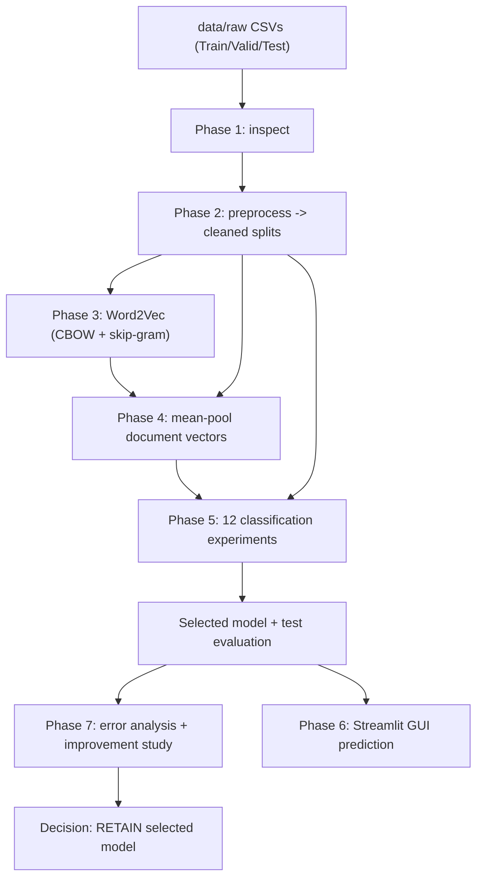

# 01 — Project overview and goals

## The problem

Gujarati is an Indo-Aryan language written in the **Gujarati script**, spoken by
tens of millions of people. News outlets such as ABP Asmita publish thousands of
Gujarati headlines every day. A useful first step in any news product is to sort
each article into a **category** (Politics/Nation, Sports, Business, and so on).

This project builds a **text classifier**: give it a Gujarati news headline, and
it returns the single most likely category out of ten, together with a score for
every category.

Because Gujarati is **morphologically rich** (words carry a lot of grammar in
their endings) and the dataset is modest in size, the project deliberately uses
**classical machine-learning methods** rather than deep neural networks:

- Word embeddings trained with **Word2Vec** (a lightweight, well-understood
  method), and
- Four classic scikit-learn classifiers.

This keeps training fast, results reproducible, and the whole pipeline
explainable — an excellent learning project and a solid, dependency-light
baseline.

## What the system predicts

Ten categories (defined in `config.py` as `CATEGORY_LABELS`):

| Category | Roughly means |
| --- | --- |
| State | News about Gujarat state and local governance |
| International | World affairs, foreign countries |
| Entertainment | Films, celebrities, culture, events |
| Business | Economy, markets, prices, companies |
| Nation | Indian national politics and policy |
| Technology | Gadgets, science, apps, IT |
| Sports | Cricket and other sports |
| Astro | Astrology and horoscopes |
| Crime | Police, arrests, court and law-and-order |
| Auto | Cars, vehicles, transport |

A common observation in the error analysis (Chapter 08) is that **State / Nation
/ International overlap heavily**, as do **Business / Nation / Technology** —
these are genuinely fuzzy boundaries even for humans.

## The eight phases of the project

The work was organised into numbered phases, each with its own implementation
plan under `docs/superpowers/plans/`:

| Phase | Name | Produces |
| --- | --- | --- |
| 1 | Dataset inspection | `reports/dataset_inspection_report.txt` |
| 2 | Preprocessing | `src/preprocessing.py`, `reports/preprocessing_report.txt` |
| 3 | Word2Vec training | `models/word2vec_{cbow,skipgram}.model`, report |
| 4 | Document vectors | `data/processed/*.docvecs.npz` + `.meta.json`, report |
| 5 | Classification | `models/classifiers/*`, `reports/classification_*` |
| 6 | GUI | `app/streamlit_app.py`, `app/content.py`, `app/README.md` |
| 7 | Error analysis + improvement | `reports/error_analysis/*`, `reports/experiments/*` |
| 8 | Documentation | **this handbook** |

## End-to-end architecture

> Diagram A — end-to-end flow (Mermaid source:
> [`diagrams/A_system_architecture.mmd`](diagrams/A_system_architecture.mmd)).

*(The full-size diagrams live in [`diagrams/`](diagrams/README.md).)*

## Headline results

All numbers below are copied from the repository's own reports.

**Model selection (validation only)** — best of 12 experiments
(`reports/classification_validation_table.md`):

| Rank | Feature | Classifier | Macro-F1 | Accuracy |
| --- | --- | --- | --- | --- |
| 1 | Skip-gram doc vectors (100d) | gradient_boosting | 0.8883 | 0.8947 |
| 2 | Skip-gram doc vectors (100d) | logistic_regression | 0.8837 | 0.8896 |
| 3 | Skip-gram doc vectors (100d) | linear_svm | 0.8774 | 0.8848 |
| 4 | TF-IDF word n-grams | linear_svm | 0.8729 | 0.8747 |

**Frozen test evaluation** of the selected model
(`reports/classification_test_report.txt`):

| Metric | Value |
| --- | --- |
| Accuracy | 0.8953 |
| Macro precision | 0.8966 |
| Macro recall | 0.8862 |
| **Macro F1** | **0.8910** |
| Weighted F1 | 0.8952 |
| Test rows | 9,972 |

**Best and worst categories on test:** Sports (F1 0.9547) and Astro (F1 0.9672)
are easiest; Nation (0.7741) and Crime (0.7901) are hardest.

**Phase 7 outcome:** a further 15 experiments (exp100–exp114) were run on
validation. The best improved macro-F1 by only **+0.0006**, below the project's
**+0.005** replacement threshold, so the decision was to **RETAIN** the Phase 5
selected model (`reports/experiments/recommendation.md`). See Chapter 08.

## Scope, goals, and non-goals

**Goals**

- A reproducible, explainable, Gujarati-aware text-classification pipeline.
- No paid services, no network dependency at inference time, no deep learning.
- A clean GUI for non-technical users.
- Honest evaluation: select on validation, touch the test split exactly once.

**Non-goals (by design)**

- No deep-learning transformers (BERT-style) — intentionally out of scope.
- No automatic hyper-parameter search beyond the planned experiment grid.
- Not a production service: there is no REST API, database, or deployment config.
- The model predicts a **single** category per headline; it is not multi-label.

## Technology at a glance

Python 3.11 · pandas · NumPy · **gensim** (Word2Vec) · **scikit-learn**
(classifiers, TF-IDF, SVD, metrics) · joblib (model persistence) · matplotlib +
seaborn (plots) · **Streamlit** (GUI) · pytest (tests). Full details in
`requirements.txt` and Chapter 11.

Next: [Chapter 02 — Repository map](02_repository_map.md).
