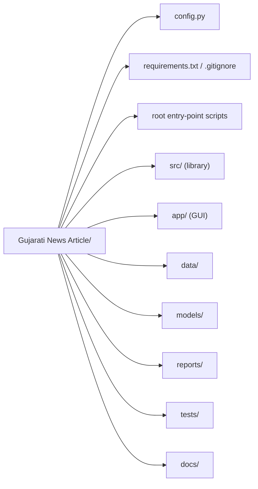

# 02 — Repository map

This chapter is your map of the codebase. Read it once and you will know where
everything lives.

## Top-level layout

A useful mental model: **`src/` is the library; the root scripts are thin
command-line front doors; `app/` is the interactive front door; `config.py` is
the single source of truth for paths, column names, and constants.**

## `config.py` — the control panel

Everything path- and constant-related is centralised here (199 lines):

- **Paths:** `PROJECT_ROOT`, `DATASET_DIR` (`data/raw`), `PROCESSED_DIR`
  (`data/processed`), `MODELS_DIR`, `CLASSIFIERS_DIR`, `EXPERIMENTS_DIR`,
  `REPORTS_DIR`, `ERROR_ANALYSIS_DIR`, `EXPERIMENTS_REPORT_DIR`, and the three
  CSV paths `TRAIN_PATH` / `VALID_PATH` / `TEST_PATH`.
- **Data contract:** `DATA_FORMAT = "SHC"`, `TEXT_COLUMN = "text"`,
  `LABEL_COLUMN = "labels"`, `TRAIN_ENCODING = "utf-8-sig"`.
- **Categories:** `CATEGORY_LABELS` — the 10 class names.
- **Modelling constants:** `RANDOM_SEED = 42`, `FEATURE_CONFIGURATIONS`,
  `TFIDF_WORD_PARAMS`, `W2V_MODEL_SKIPGRAM_PATH`, `W2V_MODEL_CBOW_PATH`,
  `CLASSIFIER_SVD_COMPONENTS`, and `REPLACEMENT_THRESHOLD = 0.005` (Phase 7).

> Why a single config? Because a stage like "where is the skip-gram model?"
> should have exactly one answer, so the pipeline, the GUI, and the tests all
> agree.

## Root entry-point scripts

Each script is a thin wrapper that calls the matching module and prints a
report. Run them from the project root.

| Script | Calls | Writes |
| --- | --- | --- |
| `inspect_dataset.py` | `src/dataset_inspection.py` | `reports/dataset_inspection_report.txt` |
| `preprocess_dataset.py` | `src/preprocessing.py` | `reports/preprocessing_report.txt` (+ optional `data/processed/*.preprocessed.csv`) |
| `train_word2vec.py` | `src/word2vec_trainer.py` | `models/word2vec_*.model`, `reports/word2vec_training_report.txt` |
| `generate_document_vectors.py` | `src/document_vectors.py` | `data/processed/*.docvecs.npz` + `.meta.json`, report |
| `run_classification.py` | `src/classification.py` | `models/classifiers/*`, `reports/classification_*` |
| `run_error_analysis.py` | `src/error_analysis.py` | `reports/error_analysis/*` |
| `run_model_improvement.py` | `src/experiments.py` | `models/experiments/*`, `reports/experiments/*` |

## `src/` — the library modules

| Module | Responsibility |
| --- | --- |
| `data_loader.py` | Read the three CSVs into a `DatasetSplits` object; structural validation. |
| `dataset_inspection.py` | Phase 1 reconnaissance and report. |
| `preprocessing.py` | Clean + tokenize Gujarati text (deterministic, reusable). |
| `word2vec_trainer.py` | Train CBOW and Skip-gram models; write report. |
| `document_vectors.py` | Mean-pool word vectors into 100-d headline vectors. |
| `text_features.py` | Load doc vectors; build leakage-safe TF-IDF; SVD reduction. |
| `evaluation.py` | Metrics, experiment records, comparison tables, plots. |
| `classification.py` | Estimators, experiment runner, model selection, save/load. |
| `prediction.py` | `NewsClassifier` — the single-inference interface. |
| `error_analysis.py` | Phase 7 error grouping and reporting. |
| `experiments.py` | Phase 7 improvement experiments + retain/replace decision. |

## `app/` — the GUI

| File | Role |
| --- | --- |
| `streamlit_app.py` | The Streamlit view (671 lines): hero, input box, result, scores, category grid, model info. |
| `content.py` | Static content and pure helpers (273 lines): `CATEGORY_INFO`, `EXAMPLE_HEADLINES`, `METHODOLOGY_STEPS`, `MODEL_DISPLAY`, score formatting. Importable **without** Streamlit so it is unit-testable. |
| `README.md` | App-specific run/usage/troubleshooting notes. |

## `data/`

| Folder | Contents |
| --- | --- |
| `data/raw/` | The three original CSVs: `Gujarati_SHC_LDC_LPC_Train.csv`, `..._Valid.csv`, `..._Test.csv`. Never modified by the pipeline. |
| `data/processed/` | `*.docvecs.npz` + `*.meta.json` per model per split (the model inputs). Also `*.preprocessed.csv` cleaned-text dumps that are **regenerable and not read at runtime** (see Chapter 10). |

## `models/`

| Path | Contents |
| --- | --- |
| `word2vec_cbow.model` (+ `.wv.vectors.npy`) | Trained CBOW embeddings. |
| `word2vec_skipgram.model` (+ `.wv.vectors.npy`, `.syn1neg.npy`) | Trained Skip-gram embeddings — **required at inference**. |
| `classifiers/selected_model.joblib` | The chosen classifier + metadata. |
| `classifiers/exp001..exp012` | The 12 Phase 5 experiment artifacts. |
| `experiments/exp100..exp114` | The 15 Phase 7 experiment artifacts. |
| `backup/*.corrupted-raw-train.model` | Archived corrupted model files kept for reference. |

## `reports/`

Human-readable evidence of every phase: `dataset_inspection_report.txt`,
`preprocessing_report.txt`, `word2vec_training_report.txt`,
`document_vectors_report.txt`, `classification_report.txt` (Phase 5),
`classification_test_report.txt`, `classification_validation_table.md`,
`classification_experiments.csv|json`, plus `reports/error_analysis/` and
`reports/experiments/` from Phase 7.

## `tests/`

15 pytest files covering every module (see Chapter 10). Notable specifics:
`tests/conftest.py` holds shared fixtures, and two tests intentionally write real
reports as a side effect — read Chapter 10 before running the full suite if you
care about report contents.

## `docs/`

`docs/superpowers/plans/` holds the five phase implementation plans (primary
sources for this handbook); `docs/project_handbook/` is this handbook.

## A suggested reading order in the code

1. `config.py` — the vocabulary of the project.
2. `src/data_loader.py` — how data enters.
3. `src/preprocessing.py` — how text is cleaned.
4. `src/word2vec_trainer.py` → `src/document_vectors.py` — how text becomes numbers.
5. `src/text_features.py` → `src/classification.py` → `src/evaluation.py` —
   how numbers become a model and a score.
6. `src/prediction.py` → `app/streamlit_app.py` — how a user gets an answer.
7. `src/error_analysis.py` → `src/experiments.py` — how the model was audited.

Next: [Chapter 03 — The dataset](03_datasets.md).
