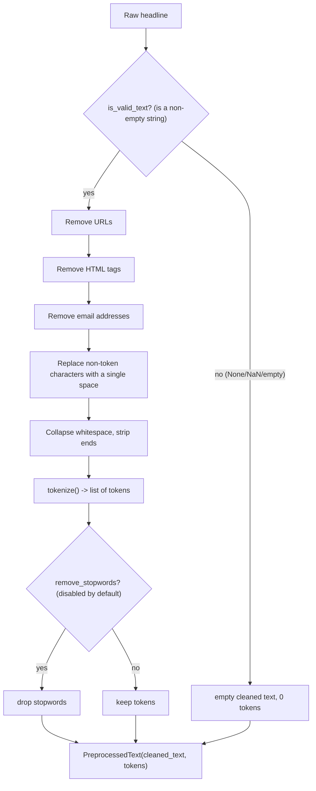

# 04 — Text preprocessing

**Module:** `src/preprocessing.py` · **Entry point:** `preprocess_dataset.py` ·
**Report:** `reports/preprocessing_report.txt`

## Why preprocess at all?

Raw headlines are messy. They contain URLs, HTML fragments, email addresses,
punctuation, extra whitespace, and sometimes nothing at all. Word2Vec learns from
**tokens** (words), so before training we must turn each string into a clean list
of tokens — without changing Gujarati's meaning.

The guiding principle for this project: **clean conservatively**. It removes
noise but never strips Gujarati's own characters, and it never changes text in a
way that would alter meaning.

## The Gujarati-script concern

Gujarati is written with consonants plus **vowel signs** (matras) and other
combining marks in the Unicode range **U+0ABE–U+0AC5**. These marks change how a
letter is pronounced. A naive "remove non-alphanumeric characters" step would
**destroy** Gujarati words by deleting the matras.

So the design explicitly guarantees: **vowel signs survive cleaning and
tokenization unchanged.** This is the single most important rule in this module,
and a dedicated test enforces it.

## The pipeline, step by step



Key details:

- **URL / HTML / email removal** happens first so their characters never leak
  into tokens.
- **Punctuation → space (not delete).** Replacing a comma with a *space* prevents
  accidentally gluing two words together; deleting it would merge them.
- **Whitespace collapse** is deterministic, so calling the cleaner twice gives
  the same result (important for reproducibility).
- **Stopword removal is off by default.** Gujarati has very frequent function
  words (like છે / અને), but removing them by default risks harming short
  headlines; the project exposes a documented, small stopword list and leaves it
  **optional**.

## The main API

All functions are pure and deterministic (given the same input, always the same
output), and type-annotated:

| Function | Purpose |
| --- | --- |
| `is_valid_text(x)` | `True` only for a non-empty string; `False` for `None`/NaN/empty. |
| `clean_text(text)` | Removes URLs/HTML/emails, replaces non-token chars with space, collapses whitespace. |
| `normalize_whitespace(text)` | Deterministic whitespace collapse/trim. |
| `tokenize(text)` | Splits cleaned text into a list of tokens. |
| `remove_stopwords(tokens)` | Optional stopword removal. |
| `preprocess(text)` | One call → a `PreprocessedText` dataclass with `cleaned_text` and `tokens`. |
| `add_preprocessed_columns(df)` | Returns a **copy** with added cleaned columns; original text and labels preserved. |
| `preprocess_splits(splits)` | Applies the above to all three splits. |
| `build_preprocessing_report(...)`, `write_report(...)` | Build/write `reports/preprocessing_report.txt`. |
| `run_preprocessing_pipeline(...)` | End-to-end: load → preprocess → report (+ optional save). |

## Design decisions worth remembering

| Decision | Reason |
| --- | --- |
| Never modify the original CSVs. | Reproducibility; originals are the source of truth. |
| Keep original text alongside cleaned text (`PreprocessedText`). | Debugging and auditing — you can always see what was removed. |
| Replace punctuation with spaces, not with nothing. | Avoid joining unrelated words. |
| Deterministic, side-effect-free functions. | Reusable identically at training and inference time. |
| No English stemming, no English stopword list, no meaning-changing normalization. | The target language is Gujarati; English tools would corrupt it. |
| Stopwords optional and off. | Avoid throwing away signal in short headlines. |

## An illustrative before/after

```
input : "ગુજરાતી સમાચાર,! https://example.com વાંચો"
clean : "ગુજરાતી સમાચાર વાંચો"
tokens: ["ગુજરાતી", "સમાચાર", "વાંચો"]
```

*(Illustrative only — used to show the effect of URL and punctuation handling.)*

## Robustness rules (enforced by tests)

- `None`, `NaN`, or an empty string **never** raises; they yield empty text and
  zero tokens.
- Gujarati vowel signs are preserved exactly.
- Repeated calls produce identical output.
- Labels and original columns are untouched.
- Processing one split never loads another format.

## Where preprocessing is reused

The **same** `preprocess()` function is used to prepare Word2Vec training
sentences (Chapter 05), to build document vectors (Chapter 06), and at **inference
time** in the GUI (Chapter 09). This consistency is deliberate: if training and
inference cleaned text differently, the model would see a different distribution
and accuracy would drop.

Next: [Chapter 05 — Word2Vec embeddings](05_word2vec.md).
