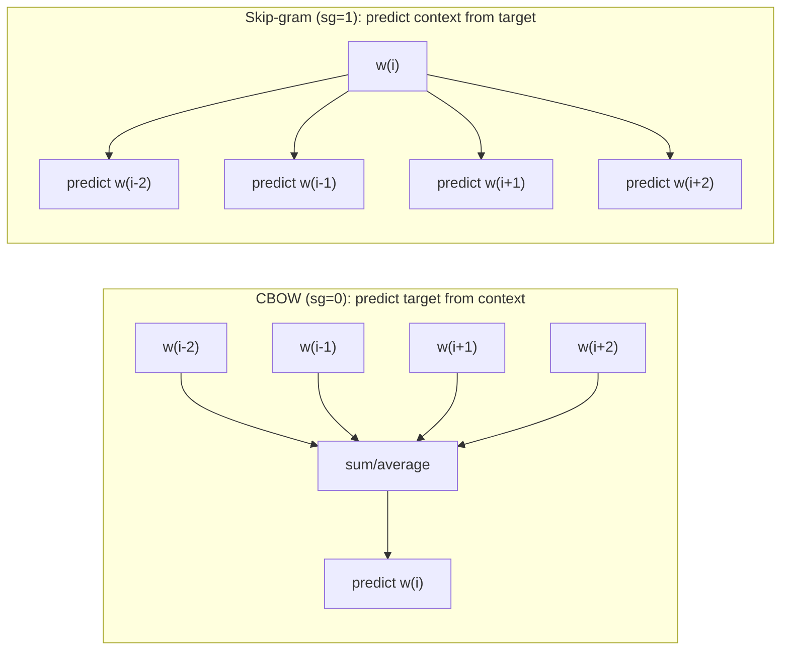

# 05 — Word2Vec embeddings

**Module:** `src/word2vec_trainer.py` · **Entry point:** `train_word2vec.py` ·
**Report:** `reports/word2vec_training_report.txt`

## The idea in one minute

A computer cannot compare words directly, but it can compare **numbers**. A word
**embedding** assigns each word a list of numbers (a vector) such that words used
in similar contexts end up with similar vectors. "Similar" here means
*geometrically close*, e.g. by cosine similarity.

**Word2Vec** (Mikolov et al., 2013) is a classical, fast method to learn these
vectors from raw text *without any labels*. It does this by repeatedly solving a
simple prediction game over a sliding window of words. Because it needs no labels,
it can learn from all 78,806 training headlines — labels are never used here.

The trained vectors capture real relationships. The report's nearest-neighbour
probe for the word **'ગુજરાતી'** ("Gujarati") returns related words:

- CBOW: `રંગભૂમિમાં` (0.599), `ઝુલન` (0.588), `પંજાબી` (0.585), `મલયાલમ` (0.558), `નાયિકા` (0.557)
- Skip-gram: `આલ્બમની` (0.648), `રચનાઓથી` (0.640), `રંગભૂમિમાં` (0.626), `રમાનારો` (0.613), `ફરજીજિયાત` (0.610)

*(Illustrative interpretation: these are artists/languages/creative terms, which
is plausibly "news about culture/language" — a good sign the embeddings learned
something meaningful.)*

## CBOW vs Skip-gram

Two training variants are trained here. They differ only in which direction the
prediction runs.



| | CBOW | Skip-gram |
| --- | --- | --- |
| Predicts | the centre word from its neighbours | each neighbour from the centre word |
| Speed | faster | slower |
| Rare words | tends to smooth them away | usually represents them better |
| In this project | `sg=0` | `sg=1` — **the winner** |

In practice, Skip-gram produced the better downstream classifier here, which is
consistent with it handling rarer vocabulary more gracefully.

## Exact training configuration

Both models were trained on the cleaned **train split only** with identical
settings (from the report):

| Parameter | Value | Meaning |
| --- | --- | --- |
| `vector_size` | 100 | each word becomes 100 numbers |
| `window` | 5 | look 5 words left/right for context |
| `min_count` | 2 | ignore words seen only once |
| `workers` | 8 | parallel training threads |
| `seed` | 42 | reproducibility |
| `epochs` | 10 | passes over the data |
| `sg` | 0 (CBOW) / 1 (Skip-gram) | the variant |

Training facts (verified):

- Training headlines processed: **78,806**; empty token lists: **0**.
- Tokens discarded for being too rare (`freq < min_count`): **18,539**.
- Rows containing Gujarati: **78,606**; Gujarati Unicode characters:
  **54,358,451**.
- **Vocabulary size: 210,459** words (both models).
- Gujarati words in vocabulary: **179,442 / 210,459 (85.3%)**.
- Model artifact size: ≈ **9.37 MB** each (9,369,176 / 9,369,178 bytes).

> **Reproducibility note:** the report records `gensim fast version: 0`, meaning
> the exact-match, deterministic training path was used. This supports the
> "same seed → same vectors" expectation, though identical results across
> machines/thread counts is best treated as *likely, not guaranteed*.

## Leakage discipline

The report states plainly: validation and test text were **not** used to train
the embeddings, and the labels were **not** used at all (Word2Vec is
unsupervised). This is essential — if the embeddings had seen test text, the
final test scores would be optimistic and meaningless.

## The artifacts on disk (and an important subtlety)

Gensim saves a Word2Vec model as a `.model` file **plus** sidecar NumPy files:

```
models/word2vec_skipgram.model
models/word2vec_skipgram.model.wv.vectors.npy   # the embedding matrix
models/word2vec_skipgram.model.syn1neg.npy      # training weights
```

**These sidecars are required.** `Word2Vec.load(...)` fails if the
`.wv.vectors.npy` (and `.syn1neg.npy`) files are missing. This matters for
deployment: copying only the `.model` file is a common mistake. See the GUI
chapter's troubleshooting section.

## Why 100 dimensions?

100 is a common, well-balanced choice: enough capacity to encode meaning, small
enough to train quickly and keep the downstream feature vectors compact. It also
means every headline becomes a 100-number vector (Chapter 06) — a very usable
size for gradient boosting.

## Out-of-vocabulary (OOV) words

Any word not in the 210,459-word vocabulary is **OOV**. The model simply cannot
look it up. OOV is expected, especially in validation/test (the vocabulary was
learned from train alone, so validation/test naturally contain unseen words):
the test split had **42,919 OOV tokens**. The document-vector stage decides how
to handle them (Chapter 06) — it skips OOV tokens rather than treating them as
zeros, so they do not dilute the averages.

Next: [Chapter 06 — Document vectors](06_document_vectors.md).
