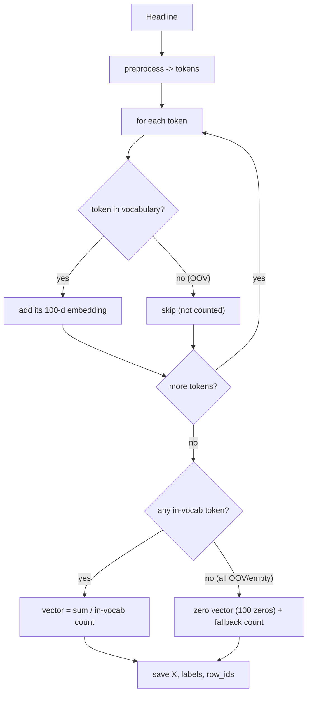

# 06 — Document vectors

**Module:** `src/document_vectors.py` · **Entry point:**
`generate_document_vectors.py` · **Report:** `reports/document_vectors_report.txt`

## The problem this stage solves

A **word vector** is fixed-length (100 numbers), but a **headline** is a variable
number of words. Classifiers like gradient boosting need **one fixed-length row
per headline**. So we must compress each headline's words into a single vector.
This "whole document → one vector" object is called a **document vector** (here,
really a headline vector).

## The method: mean pooling

The project uses **mean pooling**: take the 100-d vector of each word in the
headline, add them up, and divide by the number of words. The result is a single
100-d vector that summarises the headline.

### Two subtle rules that matter

1. **OOV tokens are skipped, not zeroed.** If a headline has 10 tokens and 2 are
   OOV, the average divides by **8**, not 10. Treating OOV as a zero vector would
   pull the headline's vector toward the origin and blur its meaning — a classic
   mistake this design deliberately avoids.
2. **The all-OOV fallback.** If *every* token is OOV (or the headline is empty),
   there is nothing to average. Instead of crash or `NaN`, the stage returns a
   **zero vector** and counts that headline as a **fallback**. Fallbacks are rare
   and are reported, not hidden.

## What is produced

For each **(model, split)** combination — 2 models × 3 splits = **6 files** —
the stage writes:

- `data/processed/<name>.<model>.docvecs.npz` — compressed arrays:
  - `X` — the feature matrix, shape `(rows, 100)`, float32
  - `labels` — the category per row
  - `row_ids` — a stable positional id (0,1,2,…) for alignment
- `data/processed/<name>.<model>.docvecs.meta.json` — a small JSON describing the
  file (model, dimension, row counts, fallback counts, OOV/in-vocab token
  totals, vocabulary size, paths).

Example filenames: `Gujarati_SHC_LDC_LPC_Train.skipgram.docvecs.npz` and its
`.meta.json`.

## Verified outputs

**Row counts match input exactly, for every split and both models**
(`reports/document_vectors_report.txt`): train **78,806**, validation **10,175**,
test **9,972**. All matrices are `(rows, 100)`, `finite=True`, and pass a
`dimension_ok=True` check.

**Fallback / OOV statistics** (identical for CBOW and Skip-gram, since the
vocabulary is identical):

| Split | Fallback (all-OOV) rows | OOV tokens | In-vocab tokens | Mean in-vocab / headline |
| --- | --- | --- | --- | --- |
| train | 1 / 78,806 (0.0013%) | 120,634 | 12,223,859 | 155.11 |
| validation | 0 / 10,175 (0.0000%) | 45,279 | 1,557,385 | 153.06 |
| test | 1 / 9,972 (0.0100%) | 42,919 | 1,516,120 | 152.04 |

Read this as a health report: only **one** headline in the entire train and test
sets was all-OOV, and none in validation. The mean number of usable words per
headline (~152) is high because many "headlines" are full article bodies.

**Label and row-order alignment** are explicitly checked: `row_ids_sequential=True`
and `labels_aligned=True` for all six files. This guarantees row *i* of the
feature matrix, its label, and its `row_id` all refer to the same headline — a
prerequisite for trustworthy training and evaluation.

## Leakage discipline

The report confirms: models were loaded **read-only**, Word2Vec was **not**
retrained, no classifier was trained, and validation/test text was never used to
train or update the embeddings.

## Why this design is a good choice

- **Fixed length** — works with any tabular classifier.
- **Uses meaning** — because the pooled word vectors are semantic, similar
  headlines land near each other even with different wording.
- **Simple and fast** — mean pooling is trivial to compute and to explain.
- **Honest about failure** — the rare all-OOV case is handled explicitly and
  measured rather than ignored.

## Limitation to be aware of

Mean pooling ignores **word order** and **which word matters most**. "The budget
was a disaster for the common man" and "The common man was a disaster for the
budget" would pool to the same vector. For headline classification this is
usually acceptable, and the strong results (Chapter 07) bear that out. Converting
a headline to a vector is also O(1) per word: fast enough for interactive use,
which is why the GUI can predict instantly.

Next: [Chapter 07 — Classification](07_classification.md).
