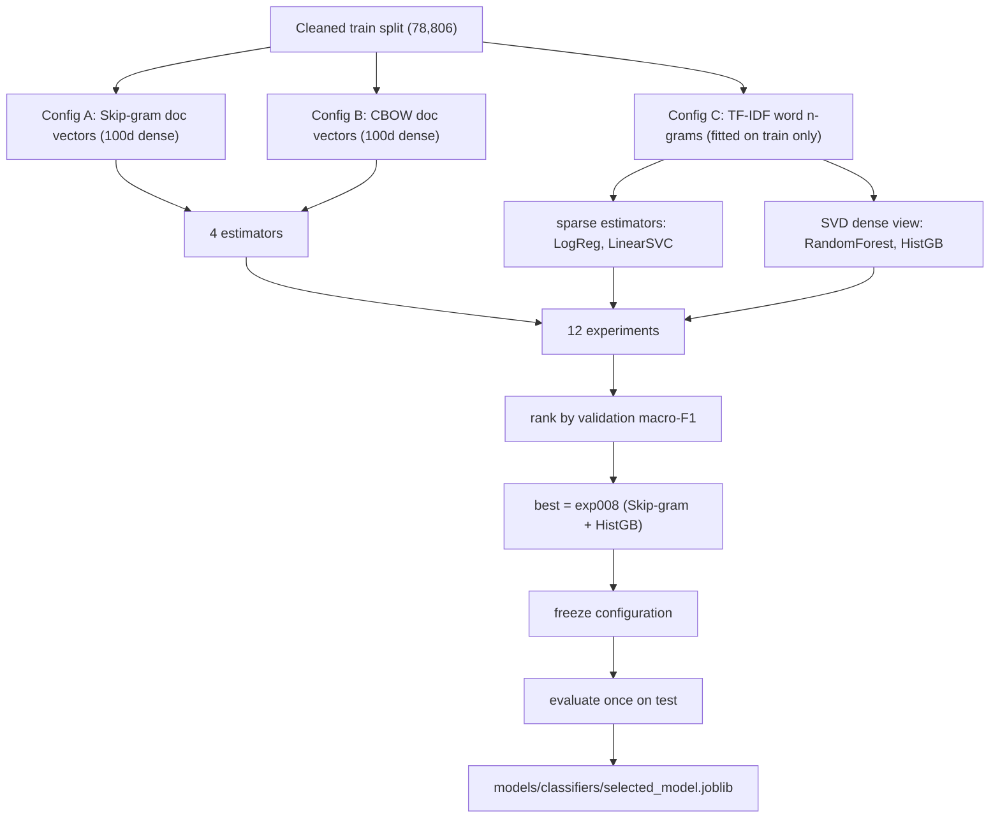

# 07 — Classification

**Modules:** `src/text_features.py`, `src/evaluation.py`, `src/classification.py`,
`src/prediction.py` · **Entry point:** `run_classification.py` ·
**Reports:** `reports/classification_report.txt` (validation),
`reports/classification_test_report.txt` (test),
`reports/classification_validation_table.md`, `reports/classification_experiments.csv|json`

## The goal

Given the 100-d document vector (or a TF-IDF representation) of a headline,
predict one of the **10 categories**. The project compares **four classifiers**
across **three feature configurations** — 12 experiments — selects the best by
**validation macro-F1**, then evaluates that single frozen configuration on the
test split once.



## The three feature configurations

| Config | Feature | Representation | Why |
| --- | --- | --- | --- |
| **A** | Skip-gram document vectors | 100-d **dense** | semantic meaning, best performer |
| **B** | CBOW document vectors | 100-d **dense** | comparison against Skip-gram |
| **C** | TF-IDF word n-grams | **sparse** | strong classical text baseline |

### A and B — dense document vectors

Loaded directly from the `.npz` files of Chapter 06 (`src/text_features.py`,
`load_docvec_split`). The loader validates the shape is 2-D, all values finite,
and `row_ids == arange`, so a corrupted or misaligned file is caught immediately.

### C — TF-IDF, and the leakage rule that defines it

**TF-IDF** (Term Frequency–Inverse Document Frequency) scores each word by how
often it appears in a headline *and* how rare it is overall — common words count
little, distinctive words count a lot. It produces a large **sparse** matrix
(one column per vocabulary word).

The critical rule (enforced by a dedicated test):

> **The TF-IDF vectorizer is fitted on the training text only.** Validation and
> test text are only *transformed* with the already-fitted vectorizer.

If the vectorizer were allowed to see validation/test words while choosing its
vocabulary, information would leak and scores would be inflated. The test suite
explicitly checks that a token appearing only in validation is **absent** from
the fitted vocabulary.

### Why trees get an SVD view

Tree models (Random Forest, Gradient Boosting) do **not** cope well with the huge
sparse TF-IDF matrix — it is both memory-heavy and statistically awkward. So for
Config C, these two estimators are trained on a **truncated-SVD** (a.k.a.
Latent Semantic Analysis) **dense** reduction with a set number of components
(`config.CLASSIFIER_SVD_COMPONENTS`). This is a **documented, justified
adaptation**, not a silent hack. Logistic Regression and Linear SVM handle the
raw sparse matrix directly, since they are built for it.

## The four classifiers

Defined in `src/classification.py` (`CLASSIFIER_NAMES`):

| Name | Model | Strength |
| --- | --- | --- |
| `logistic_regression` | multinomial logistic regression | fast, strong linear baseline |
| `linear_svm` | linear support vector classifier | sharp linear boundaries |
| `random_forest` | Random Forest | nonlinear, robust, slower |
| `gradient_boosting` | `HistGradientBoostingClassifier` | best nonlinear accuracy here |

All are deterministic given `RANDOM_SEED = 42`, and the runner records whether a
config used SVD (`reduced_dim`) etc.

## The 12 experiments and their results (validation)

Ranked by macro-F1 (`reports/classification_validation_table.md`). **The entire
selection decision used validation only.**

| Rank | Exp | Feature | Classifier | Macro-F1 | Accuracy | W-F1 | Macro-P | Macro-R |
| --- | --- | --- | --- | --- | --- | --- | --- | --- |
| 1 | 8 | Skip-gram docvec | gradient_boosting | **0.8883** | **0.8947** | 0.8942 | 0.8952 | 0.8826 |
| 2 | 5 | Skip-gram docvec | logistic_regression | 0.8837 | 0.8896 | 0.8891 | 0.8897 | 0.8787 |
| 3 | 6 | Skip-gram docvec | linear_svm | 0.8774 | 0.8848 | 0.8834 | 0.8857 | 0.8715 |
| 4 | 10 | TF-IDF | linear_svm | 0.8729 | 0.8747 | 0.8741 | 0.8793 | 0.8679 |
| 5 | 7 | Skip-gram docvec | random_forest | 0.8689 | 0.8771 | 0.8756 | 0.8847 | 0.8583 |
| 6 | 4 | CBOW docvec | gradient_boosting | 0.8628 | 0.8687 | 0.8680 | 0.8746 | 0.8536 |
| 7 | 9 | TF-IDF | logistic_regression | 0.8627 | 0.8646 | 0.8642 | 0.8810 | 0.8497 |
| 8 | 1 | CBOW docvec | logistic_regression | 0.8585 | 0.8650 | 0.8642 | 0.8654 | 0.8532 |
| 9 | 2 | CBOW docvec | linear_svm | 0.8507 | 0.8582 | 0.8563 | 0.8596 | 0.8450 |
| 10 | 3 | CBOW docvec | random_forest | 0.8337 | 0.8451 | 0.8427 | 0.8573 | 0.8199 |
| 11 | 12 | TF-IDF | gradient_boosting | 0.8137 | 0.8154 | 0.8150 | 0.8312 | 0.8012 |
| 12 | 11 | TF-IDF | random_forest | 0.7840 | 0.7857 | 0.7845 | 0.8163 | 0.7662 |

**Takeaways:**

- **Semantic document vectors beat raw TF-IDF** at the top of the table — pooling
  learned word meanings is worth more than word counts.
- **Skip-gram beats CBOW** on every estimator for the top rows.
- **Gradient boosting wins** overall, but by a modest margin over logistic
  regression (0.8883 vs 0.8837).
- Surprisingly, TF-IDF + gradient boosting / random forest (ranks 11–12) are the
  *worst* — the SVD reduction plus trees is not the strongest combination, which
  is exactly why the project ran the full grid instead of guessing.

### The selection rule

`select_best(results)` picks the highest **macro-F1**, breaking ties by accuracy.
The winner is **experiment 8**: `docvec:skipgram` + `gradient_boosting`
(`learning_rate=0.1, max_iter=200, seed=42`).

## Why macro-F1, not accuracy?

The classes are imbalanced (State ≈ 12.5k rows, Auto ≈ 2.5k). Plain **accuracy**
is dominated by the large classes and would hide poor performance on small ones.
**Macro-F1** averages the F1 of each class equally, so every category counts the
same. That makes it the honest choice for a 10-class imbalanced problem — and the
project uses it consistently for selection and reporting.

(Definitions of precision/recall/F1 are in [Chapter 11](11_glossary_and_references.md).)

## Frozen test evaluation

After selection, the configuration is **frozen** and evaluated **once** on the
untouched test split (`reports/classification_test_report.txt`):

| Metric | Value |
| --- | --- |
| Accuracy | 0.8953 |
| Macro precision | 0.8966 |
| Macro recall | 0.8862 |
| **Macro F1** | **0.8910** |
| Weighted F1 | 0.8952 |
| Test rows | 9,972 |

**Per-class test metrics** (easiest and hardest):

| Category | Precision | Recall | F1 | Support |
| --- | --- | --- | --- | --- |
| Astro | 0.9779 | 0.9567 | **0.9672** | 924 |
| Sports | 0.9627 | 0.9469 | 0.9547 | 1,035 |
| Auto | 0.9664 | 0.8649 | 0.9128 | 333 |
| State | 0.9221 | 0.9421 | 0.9320 | 1,521 |
| Entertainment | 0.9192 | 0.9245 | 0.9218 | 1,046 |
| Technology | 0.8794 | 0.8959 | 0.8876 | 855 |
| International | 0.8825 | 0.9041 | 0.8931 | 1,553 |
| Business | 0.8719 | 0.8815 | 0.8767 | 1,089 |
| Crime | 0.8033 | 0.7773 | **0.7901** | 494 |
| Nation | 0.7801 | 0.7683 | **0.7741** | 1,122 |

Distinctive categories (Astro, Sports, Auto) are easy; abstract, overlapping ones
(Nation, Crime, Business) are hard. Chapter 08 explains *why*.

## The confusion matrix (test)

The report includes the full 10×10 confusion matrix. The striking, expected
patterns:

- **Nation ↔ International / Business / Crime / Technology** dominate the errors.
- **State ↔ Crime** are heavily entangled (Crime rows predicted as State, and
  State rows predicted as Crime).
- **Auto** is often misclassified as **Technology** (both involve vehicles/gadgets).

## The inference interface

`src/prediction.py` provides the single reusable entry point:

```python
from src.prediction import NewsClassifier

clf = NewsClassifier.load("models/classifiers/selected_model.joblib")
clf.predict("ભારતે નવો રેકોર્ડ બનાવ્યો")        # -> "Nation"   (illustrative)
label, scores = clf.predict_with_scores(headline) # -> ("Nation", {..10 scores..})
```

`NewsClassifier.load` reads the joblib artifact, which includes the classifier
**and** the metadata needed to rebuild features (feature type, class names, and —
for TF-IDF models — the fitted vectorizer/SVD). For the selected doc-vector model
it also lazily loads the Skip-gram Word2Vec model to embed the headline.

**Empty or whitespace input raises a clear `ValueError`** rather than silently
predicting; a headline whose words are all OOV still returns a label via the
zero-vector path (Chapter 06).

## Artifacts produced

- `models/classifiers/exp001..exp012` — every experiment's model.
- `models/classifiers/selected_model.joblib` — the frozen winner.
- `reports/classification_report.txt` — validation-phase summary.
- `reports/classification_validation_table.md` — the ranking above.
- `reports/classification_test_report.txt` — the frozen test metrics + confusion matrix.
- `reports/classification_experiments.csv|json` — machine-readable experiment log.
- Confusion-matrix and metric-comparison **plots** under `reports/`.

Next: [Chapter 08 — Error analysis and improvement](08_error_analysis_improvement.md).
