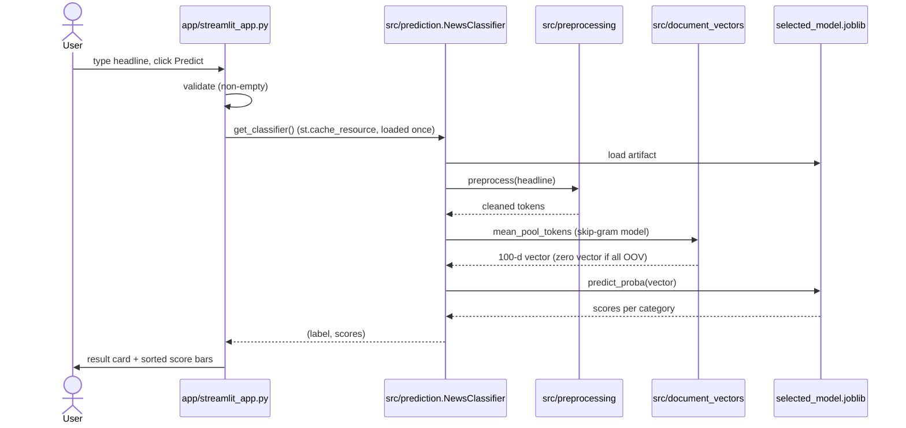

# 09 — The Streamlit GUI

**Files:** `app/streamlit_app.py` (view, 671 lines), `app/content.py`
(content + pure helpers, 273 lines), `app/README.md` (app docs) ·
**Run:** `streamlit run app/streamlit_app.py`

## What it is

A **Streamlit** web app that lets a person type a Gujarati headline and instantly
see the predicted category and the model's scores for all ten categories. It is
purely **read-only inference**: it loads the frozen selected model and never
retrains, never modifies artifacts, and needs no network access.



## Features

- Gujarati headline input (UTF-8), with empty/whitespace validation.
- Prediction card: category **icon + description + the submitted headline** and a
  short disclaimer.
- **Per-class score bars**, sorted descending, labelled by their real type —
  "probability estimate" for `predict_proba` (this model), "decision score"
  otherwise. This is an honesty feature: the UI never calls a model score a
  "guarantee".
- A **category grid** explaining all ten categories.
- **Model info** section stating the verified metrics
  (**validation macro-F1 88.83 / test macro-F1 89.10 / test accuracy 89.53**) and
  the methodology.
- **Sample Gujarati headlines** for one-click testing.
- Editorial visual style; theme-aware (Light/Dark) colours; Gujarati-safe font
  stack with fallbacks.
- Model cached via `@st.cache_resource` so it is loaded once per session.

## How the code is organised (and why)

- `app/content.py` holds **all static content and pure helper functions** —
  `CATEGORY_INFO`, `EXAMPLE_HEADLINES`, `METHODOLOGY_STEPS`, `MODEL_DISPLAY`,
  `sorted_scores`, `classify_score_type`, `format_score`, `score_to_bar_fraction`,
  and `build_theme_variables_css`. The important design choice: this module
  **imports without Streamlit**, so it can be unit-tested directly
  (`tests/test_app_content.py`).
- `app/streamlit_app.py` holds the **view only**. It bootstraps `sys.path` to the
  project root, configures the page, and renders sections
  (`render_hero`, `render_workspace`, `render_result`, `render_scores`,
  `render_categories`, `render_model_info`, `render_examples`, `render_footer`).
  It delegates all inference to `src.prediction.NewsClassifier`.

This separation (content/helpers vs. view) is why the GUI has meaningful tests
despite being a UI.

## Required artifacts

The GUI **depends on** these files already existing (never creates them):

- `models/classifiers/selected_model.joblib` — the frozen classifier.
- `models/word2vec_skipgram.model` **plus** `.wv.vectors.npy` and
  `.syn1neg.npy` — the embeddings used to build the headline vector.

If either is missing, the app shows a friendly, actionable error rather than a
stack trace.

## How to run it

From the **project root**:

```powershell
streamlit run app/streamlit_app.py
```

Then open the URL Streamlit prints (default `http://localhost:8501`). With an
explicit interpreter:

```powershell
.venv\Scripts\python.exe -m streamlit run app\streamlit_app.py
```

## Theming note

Streamlit does not expose global theme CSS variables, so the app defines every
colour as a Light/Dark **pair** using the CSS `light-dark()` function
(`build_theme_variables_css()`), following Streamlit's own Light/Dark setting.
A `:root` fallback (light values) covers browsers without `light-dark()`, and
pairwise **contrast is verified by tests** (`tests/test_app_content.py`,
including WCAG-AA checks).

## Troubleshooting

| Symptom | Cause / fix |
| --- | --- |
| "The trained model could not be found." | Check `models/classifiers/selected_model.joblib` and `models/word2vec_skipgram.model` exist relative to the project root. |
| "Input headline has no usable tokens after preprocessing." | The input was only punctuation/URLs/whitespace. Enter normal Gujarati text. |
| Gujarati shows as boxes (tofu) | Install a Gujarati-capable system font (e.g. Noto Sans Gujarati, Nirmala UI); the app already falls back across several fonts. |
| `ModuleNotFoundError: config` / `src` | Run from the project root; the app also adds the project root to `sys.path`. |
| First prediction is slow | The Word2Vec model loads lazily on first use, then is cached. |

## Honest framing (as the app itself states)

Predictions are **estimates, not guarantees** — the model can be wrong. Metrics
describe **this dataset only**, and were produced by selecting on validation and
testing once. The app is an educational NLP demonstration and runs fully offline.

Next: [Chapter 10 — Testing and operations](10_testing_and_operations.md).
