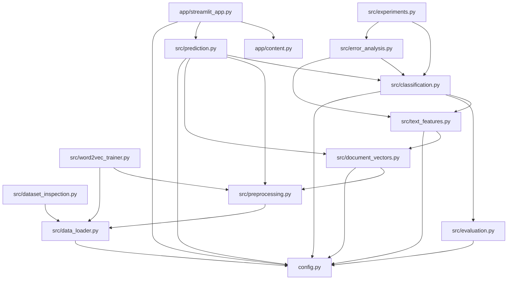

# 11 — Glossary, dependency graph, and references

## Glossary

**Accuracy** — fraction of predictions that are correct: `correct / total`. Can
be misleading when classes are imbalanced.

**Classifier** — a model that assigns a category to an input.

**Confusion matrix** — a table of true category (rows) vs. predicted category
(columns); its diagonal is correct predictions, off-diagonal cells are errors.

**Corpus** — a collection of text (here, the news headlines).

**Cosine similarity** — a measure of how similar two vectors are by the angle
between them (1.0 = identical direction). Used to show nearest-neighbour words.

**CBOW (Continuous Bag of Words)** — a Word2Vec variant that predicts a word from
its surrounding context (`sg=0`).

**Data leakage** — accidentally letting a model see information it shouldn't
during training, e.g. test data; produces falsely optimistic scores. The project
guards against this at every stage.

**Dense vector** — a vector with mostly non-zero values (e.g. a 100-d embedding).

**Document vector** — a fixed-length vector summarising a whole headline,
produced here by **mean pooling** its word vectors.

**ECE (Expected Calibration Error)** — how far predicted probabilities deviate
from observed frequencies; lower is better.

**Embedding** — see *word vector*.

**F1 score** — the harmonic mean of precision and recall; balances the two.
`F1 = 2·P·R / (P + R)`.

**Fallback (zero vector)** — the 100-d all-zeros vector used when a headline has
no in-vocabulary tokens.

**Gradient boosting / HistGradientBoostingClassifier** — an ensemble that builds
many small decision trees sequentially, each correcting the previous ones'
errors. The project's best classifier.

**Jaccard similarity** — size of the intersection of two sets divided by their
union; used to measure vocabulary overlap between categories.

**joblib** — a Python library for saving/loading model objects efficiently.

**Macro-F1** — the average of each class's F1, treating all classes equally.
The project's **selection metric** because classes are imbalanced.

**Matra / vowel sign** — a combining mark in the Gujarati script (Unicode
U+0ABE–U+0AC5) that modifies a consonant's pronunciation; intentionally preserved
during cleaning.

**Mean pooling** — averaging a set of vectors into one.

**min_count** — Word2Vec setting; words rarer than this are dropped (here, 2).

**OOV (Out-Of-Vocabulary)** — a token the embedding model has no vector for.

**Precision** — of the items predicted as class X, the fraction actually of class
X. (How *trustworthy* a positive prediction is.)

**Recall** — of the items actually of class X, the fraction the model found. (How
*complete* it is.)

**Recall/support** — *support* is the number of true examples of a class.

**Seed** — a number that makes randomised algorithms reproducible (`RANDOM_SEED = 42`).

**Skip-gram** — a Word2Vec variant that predicts surrounding words from a centre
word (`sg=1`); the winner here.

**Sparse vector / matrix** — one with mostly zero values (e.g. TF-IDF); stored
efficiently.

**SVD (Truncated SVD)** — a dimensionality-reduction technique; used to give tree
models a compact dense view of TF-IDF features.

**TF-IDF** — Term Frequency–Inverse Document Frequency; a numerical weight for
each word reflecting how distinctive it is.

**Token / tokenization** — a token is a word (or similar unit); tokenization is
splitting text into tokens.

**Word2Vec** — an unsupervised method (Mikolov et al., 2013) that learns word
embeddings by predicting context/target words.

## Python module dependency graph

`config.py` is the root every module depends on; `prediction.py` sits at the top
of the library and is what the GUI consumes.

## Phase plans (primary design sources)

- `docs/superpowers/plans/2026-10-17-gujarati-preprocessing.md`
- `docs/superpowers/plans/2026-10-17-gujarati-document-vectors.md`
- `docs/superpowers/plans/2026-10-17-gujarati-classification.md`
- `docs/superpowers/plans/2026-10-17-gujarati-gui.md`
- `docs/superpowers/plans/2026-10-18-gujarati-error-analysis-model-improvement.md`

## Generated reports (the project's own evidence)

| Report | Contents |
| --- | --- |
| `reports/dataset_inspection_report.txt` | Phase 1 data reconnaissance |
| `reports/preprocessing_report.txt` | Phase 2 cleaning statistics |
| `reports/word2vec_training_report.txt` | Phase 3 embeddings, params, vocab |
| `reports/document_vectors_report.txt` | Phase 4 vector shapes, fallbacks, alignment |
| `reports/classification_report.txt` | Phase 5 validation summary |
| `reports/classification_validation_table.md` | The 12-experiment ranking |
| `reports/classification_test_report.txt` | Frozen test metrics + confusion matrix |
| `reports/classification_experiments.csv` / `.json` | Machine-readable experiment log |
| `reports/error_analysis/baseline_reproduction.md` | Phase 7 baseline check |
| `reports/error_analysis/validation_error_analysis.md` | Misclassified rows, confusion pairs |
| `reports/error_analysis/error_cause_investigation.md` | Length/overlap/script analysis |
| `reports/experiments/validation_comparison.md` | Phase 7 experiment ranking |
| `reports/experiments/recommendation.md` | Retain/replace decision |
| `reports/experiments/validation_probability_quality.json` | Calibration metrics |

## Key source files (quick reference)

- Data contract & constants: `config.py`
- Data entry: `src/data_loader.py`
- Cleaning: `src/preprocessing.py`
- Embeddings: `src/word2vec_trainer.py`, `models/word2vec_*.model`
- Headline vectors: `src/document_vectors.py`, `data/processed/*.npz`
- Features: `src/text_features.py`
- Metrics: `src/evaluation.py`
- Models & selection: `src/classification.py`
- Inference: `src/prediction.py`
- Audit: `src/error_analysis.py`, `src/experiments.py`
- GUI: `app/streamlit_app.py`, `app/content.py`

## External references (concepts used)

- T. Mikolov et al., *Efficient Estimation of Word Representations in Vector
  Space* (2013) — Word2Vec.
- Gensim documentation — `Word2Vec`.
- scikit-learn documentation — `LogisticRegression`, `LinearSVC`,
  `RandomForestClassifier`, `HistGradientBoostingClassifier`, `TfidfVectorizer`,
  `TruncatedSVD`, metrics.
- Streamlit documentation — building data apps.
- Unicode Standard — Gujarati block (U+0A80–U+0AFF).

These are the standard references for the algorithms; the project does not quote
or vendor their code beyond the listed libraries.

---

**End of handbook.** Return to the [table of contents](README.md), or start at
[Chapter 01](01_overview_and_goals.md).
