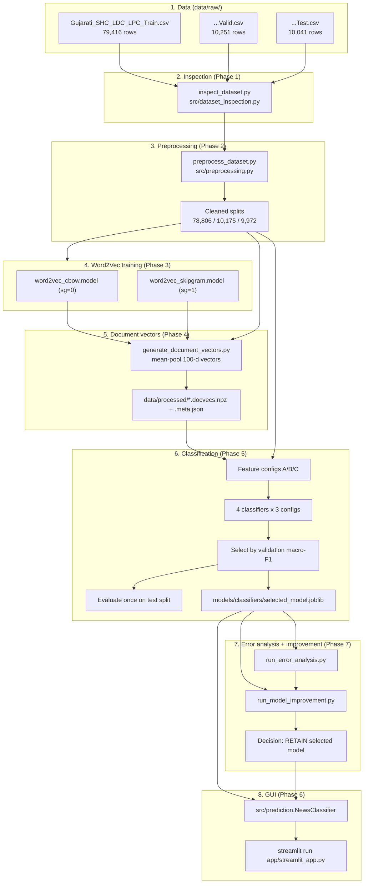
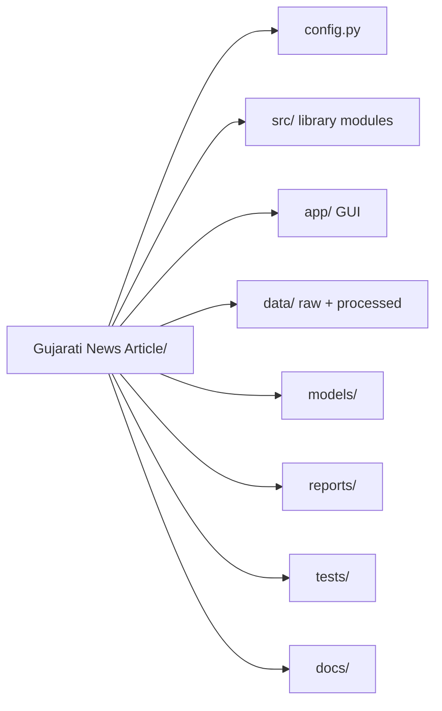
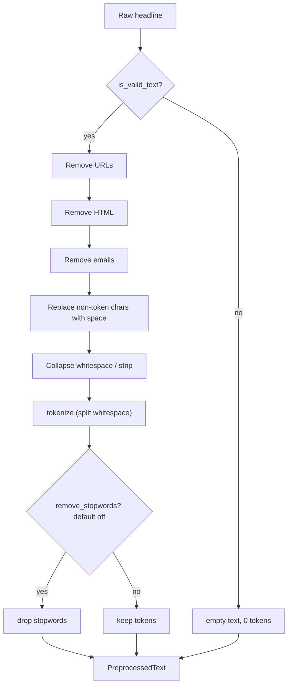
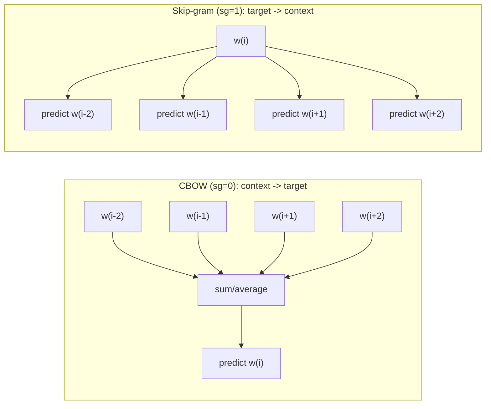
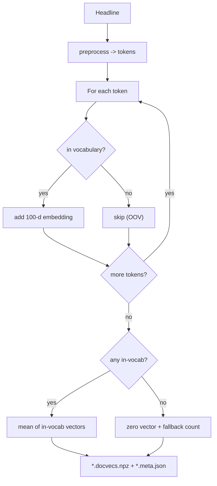
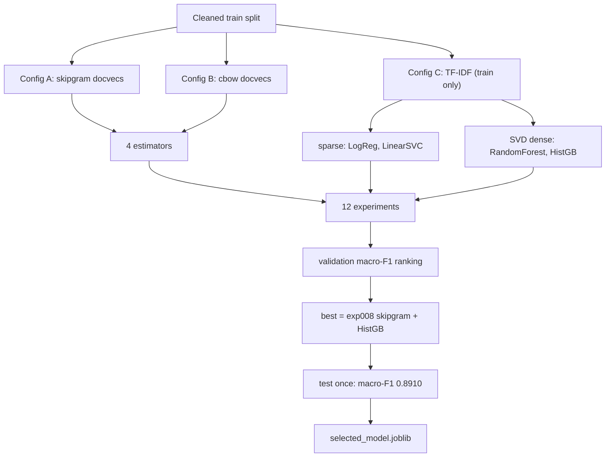
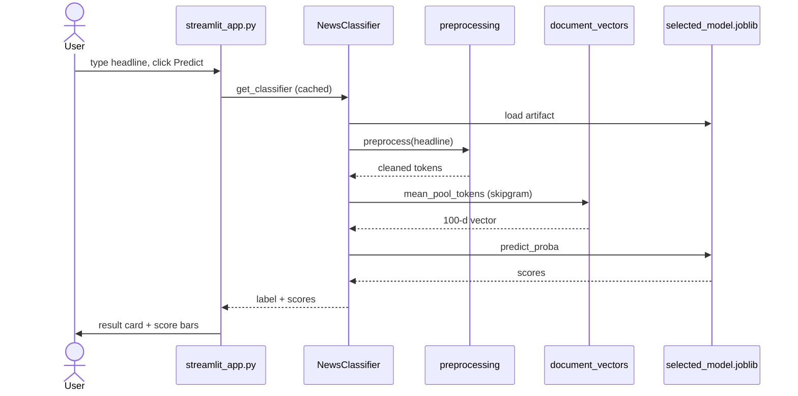
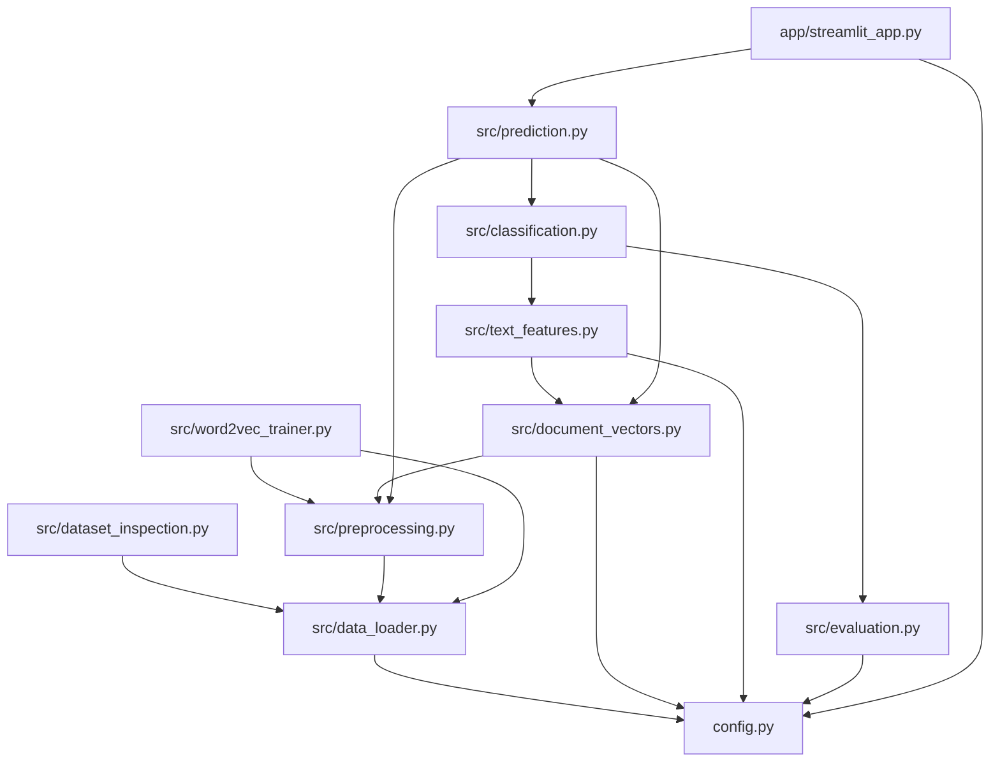

# Diagrams

This folder holds the architecture and flow diagrams for the Gujarati News
Classifier handbook. Each diagram has a Mermaid source file (`.mmd`) and is also
embedded (inline, so it renders on GitHub and in most Markdown viewers) in the
chapter that discusses it.

| File | Diagram | Shown in |
| --- | --- | --- |
| `A_system_architecture.mmd` | End-to-end system architecture | Chapter 01, 02 |
| `B_directory_map.mmd` | Repository directory map | Chapter 02 |
| `C_preprocessing_pipeline.mmd` | Text preprocessing pipeline | Chapter 04 |
| `D_cbow_vs_skipgram.mmd` | CBOW vs Skip-gram | Chapter 05 |
| `E_document_vector_generation.mmd` | Headline (document) vector generation | Chapter 06 |
| `F_classification_and_evaluation.mmd` | Experiments, selection, evaluation | Chapter 07 |
| `G_gui_inference.mmd` | GUI inference sequence | Chapter 09 |
| `H_file_dependency_graph.mmd` | Python module dependency graph | Chapter 11 |

## How to view the diagrams

1. **Inline (no tools):** open any chapter `.md` file or this file on GitHub, or
   in VS Code with the "Markdown Preview Mermaid Support" extension. The
   ```` ```mermaid ```` blocks render directly.
2. **Browser preview (no install):** open `preview.html` in any modern browser.
   It loads Mermaid from a CDN and renders all eight diagrams on one page. This
   option needs an internet connection the first time.
3. **Render to PNG/SVG (optional, requires tools not installed here):**
   ```powershell
   npx -y @mermaid-js/mermaid-cli -i A_system_architecture.mmd -o A_system_architecture.svg
   ```
   `mermaid-cli` (`mmdc`) was **not** found in this project and pulls a headless
   Chromium download, so image export was intentionally skipped.

> Note: mermaid CDN URLs in `preview.html` are for viewing the local diagrams
> only; they are not part of the application runtime.

---

## A. End-to-end system architecture



## B. Repository directory map



## C. Preprocessing pipeline



## D. CBOW vs Skip-gram



## E. Document vector generation



## F. Classification and evaluation



## G. GUI inference sequence



## H. Python module dependency graph


